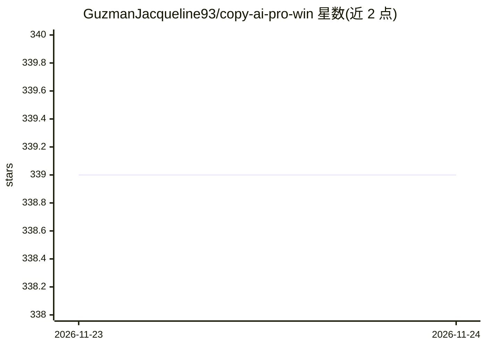

# GuzmanJacqueline93/copy-ai-pro-win

⭐ 339 · NOASSERTION · 推送 2026-11-21 · [GitHub](https://github.com/GuzmanJacqueline93/copy-ai-pro-win) · [官网](https://guzmanjacqueline93.github.io/copy-ai-pro-win/) · 个人维护

**Windows 桌面 AI 文案助手：生成营销文案并做 SEO 优化**

面向 Windows 10/11 的 AI 文案写作桌面应用：用户填写简报、选择语气与格式，由远端 AI 服务生成博客草稿、广告、产品描述等文本，再通过语气改写、可读性检查与关键词覆盖检查进行润色，支持多版本对比与版本历史，导出为 TXT/Markdown/DOCX 或剪贴板。需联网激活并调用远端 AI 服务完成生成，安装包方式分发，运行依赖 .NET Framework 4.8 与 VC++ 运行库。

## 筛选速览

| 维度 | 判定 | 备注 |
|---|---|---|
| AI 角色 | `ai-native` | 本体是模型或模型工具 |
| 许可风险 | `none` | NOASSERTION |
| 部署形态 | `None` |  |
| 模型依赖 | — | README 未给出锁定关系 |
| 硬件要求 | — | 无带数字的原话,不猜 |
| 安装摩擦 | `low` | 无编译、无系统依赖或容器化 |
| 成熟度 | — | 结构信号不足 |

## 能力要点

- 从简报生成结构化草稿，支持逐段重新生成
- 语气改写（正式/随意/说服/友好）与可读性建议
- SEO 检查：关键词覆盖、标题结构与可读性
- 导出 TXT/Markdown/DOCX 或格式化剪贴板

## 适用场景

- 为博客和落地页快速产出初稿
- 同一段文案按不同渠道改写语气
- 发布前检查关键词覆盖与可读性
- 按客户/品牌分项目管理文案

## 场景标签

`AI 写作` · 领域:内容生成

## 证据(README 行号)

> L19: Copy Ai Pro is an AI copywriting assistant for Windows that helps you generate marketing copy, blog drafts, product
> L36: |**Dependencies**|.NET Framework 4.8 or later, Microsoft Visual C++ Redistributable, and a stable internet connecti

## 星数曲线

2026-11-23 339 → 2026-11-24 339（+0）

---
*卡片 v1 · prompt 1.4 · 生成 2026-11-23 · 置信度 high · 依据 README sha `2c40ae8fdc9f` · [字段定义](../../DATASET.md)*
