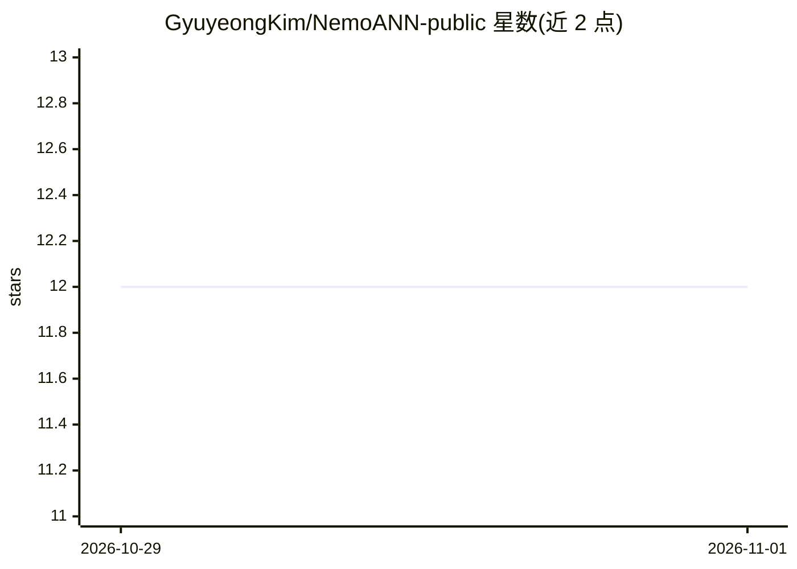

# GyuyeongKim/NemoANN-public

⭐ 12 · C++ · MIT · 推送 2026-10-26 · [GitHub](https://github.com/GyuyeongKim/NemoANN-public) · [官网](https://gyuyeongkim.github.io/papers/nemoann_socc26.pdf) · 组织维护

**SSD 图索引的过滤向量搜索研究实现（SoCC'26 论文）**

SoCC'26 论文 NemoANN 的官方实现：基于 PipeANN 的 SSD 图索引上做过滤式近似最近邻搜索。核心机制是 graph tunneling——在向 SSD 发起读取前先在内存中检查候选节点标签，未通过的节点不读盘，仅用内存中的邻居表和 PQ 距离继续遍历，不修改原索引结构。提供数据准备、构建与复现论文图表的完整实验脚本，含 DiskANN、PipeANN、Filtered-DiskANN 等基线。要求 Linux、io_uring、GCC 9+、CMake、BLAS、tcmalloc，需从源码编译，BigANN-1B 邻居表约 123 GB。

## 筛选速览

| 维度 | 判定 | 备注 |
|---|---|---|
| AI 角色 | `ai-ecosystem` | LLM/agent 周边工具 |
| 许可风险 | `permissive` | MIT |
| 部署形态 | `None` |  |
| 模型依赖 | — | README 未给出锁定关系 |
| 硬件要求 | — | 无带数字的原话,不猜 |
| 安装摩擦 | `medium` | 含编译或系统依赖之一 |
| 成熟度 | — | 结构信号不足 |

## 能力要点

- graph tunneling：过滤检查先于 SSD 读取，未命中节点不读盘
- 不修改原磁盘索引与布局，过滤谓词查询时给出
- 论文称 BigANN-100M 上 SSD 读取次数比后过滤少约 10 倍
- 提供复现论文各图表的完整脚本与基线（DiskANN/PipeANN/Filtered-DiskANN）

## 适用场景

- 复现 SoCC'26 论文的过滤向量搜索实验
- 研究 SSD 上图索引过滤搜索的 I/O 优化
- 对比 DiskANN/PipeANN 等基线的吞吐与召回

## 场景标签

`向量数据库` · 领域:知识与检索

## 证据(README 行号)

> L3: NemoANN is an SSD-based graph index for filtered approximate nearest neighbor search.
> L12: This repository contains the implementation and the experiment scripts for the paper
> L16: > ACM Symposium on Cloud Computing (SoCC '26), 2026.

## 星数曲线

2026-10-29 12 → 2026-11-01 12（+0）

---
*卡片 v1 · prompt 1.4 · 生成 2026-11-01 · 置信度 high · 依据 README sha `881a2f4ea1bf` · [字段定义](../../DATASET.md)*
