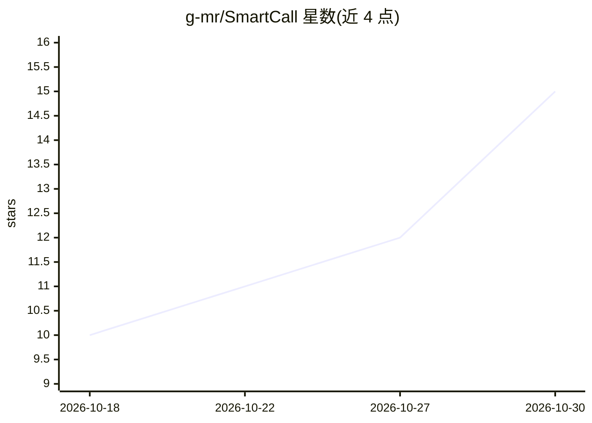

# g-mr/SmartCall

⭐ 15 · Java · Apache-2.0 · 推送 2026-10-26 · [GitHub](https://github.com/g-mr/SmartCall) · [官网](https://qidiangk.com) · 个人维护 · 中文 README

**面向企业的 AI 客服呼叫中心系统：智能应答与 IVR 编排**

基于 Java 17 / Spring Boot 3.5 / Spring Cloud 与 Asterisk PBX 构建的智能客服呼叫中心系统，提供大模型意图识别（通义千问 DashScope / DeepSeek）、ASR/TTS 多引擎语音链路、端到端实时对话模型适配、可视化 IVR 流程编排、MaxKB 知识库智能体对接与情绪分析。支持微服务与单体双模部署、多租户与 RBAC。坐席管理、智能外呼等运营模块为可扩展能力，需二次开发。提供在线演示与 Docker Compose 部署，Apache 2.0 协议。

## 筛选速览

| 维度 | 判定 | 备注 |
|---|---|---|
| AI 角色 | `ai-native` | 本体是模型或模型工具 |
| 许可风险 | `permissive` | Apache-2.0 |
| 部署形态 | `self-host` | docker 或自建部署 |
| 模型依赖 | — | README 未给出锁定关系 |
| 硬件要求 | — | 无带数字的原话,不猜 |
| 安装摩擦 | `low` | 无编译、无系统依赖或容器化 |
| 成熟度 | — | 结构信号不足 |

## 能力要点

- 大模型意图识别（正则+模型双引擎）与 MaxKB 知识库智能体多轮问答
- RealtimeModelAdapter 策略模式对接阿里云百炼端到端实时语音模型，支持 VAD 打断
- 可视化拖拽式 IVR 流程编排，含 14 类流程节点与在线调试
- 微服务/单体双模部署，多租户与 RBAC 权限体系

## 适用场景

- 搭建电商售后、金融催收等场景的智能呼入应答与外呼系统
- 通过可视化编排定制电话客服流程并接入企业知识库问答
- 在内网私有化环境部署完整 AI 呼叫中心

## 场景标签

`语音 Agent` · 领域:对话与助手

## 证据(README 行号)

> L28: **SmartCall** 是一套基于 AI 大模型 + Asterisk 通信引擎构建的新一代智能客服呼叫中心系统。系统深度融合了 **AI 语音机器人**、**智能 IVR 流程编排**、**实时语音识别（ASR）**、**语
> L44: - **大模型意图识别** — 集成通义千问（DashScope）、DeepSeek 等主流大模型，通过 Prompt 工程实现精准的来电意图分类，支持自定义意图配置

## 星数曲线

2026-10-18 10 → 2026-10-30 15（+5）

---
*卡片 v1 · prompt 1.4 · 生成 2026-10-30 · 置信度 high · 依据 README sha `f0965ea1ac95` · [字段定义](../../DATASET.md)*
