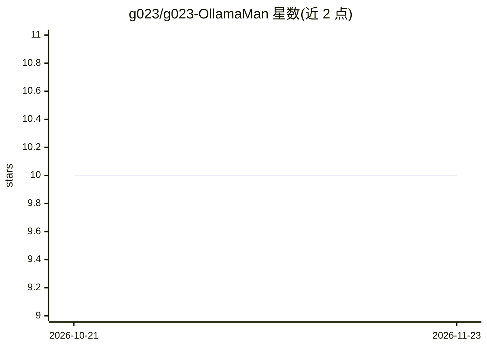

# g023/g023-OllamaMan

⭐ 10 · PHP · 推送 2025-12-17 · [GitHub](https://github.com/g023/g023-OllamaMan) · 个人维护

**浏览器中运行的 Ollama 服务器网页管理面板**

基于 PHP 的 Web 仪表盘，用于管理本地网络或远程机器上的 Ollama 服务器：模型浏览/下载/删除/复制、通过参数调节创建自定义模型、流式聊天、单轮文本生成、嵌入向量生成与可视化、服务器状态监控与 API 日志。需 PHP 7.4+ 与 cURL 扩展，部署到 Web 服务器根目录后配置 Ollama 主机端口即可使用；数据存储使用 SQLite。应用自身也对外提供 REST API。

## 筛选速览

| 维度 | 判定 | 备注 |
|---|---|---|
| AI 角色 | `ai-ecosystem` | LLM/agent 周边工具 |
| 许可风险 | `none` | — |
| 部署形态 | `None` |  |
| 模型依赖 | local-ok | 支持本地模型 |
| 硬件要求 | — | 无带数字的原话,不猜 |
| 安装摩擦 | `low` | 无编译、无系统依赖或容器化 |
| 成熟度 | — | 结构信号不足 |

## 能力要点

- 模型管理：浏览、下载（带进度）、删除、复制、查看详情
- 模型创建器：调节 temperature/top-p 等参数、系统提示词、模板与停止序列
- 聊天/生成/嵌入可视化/模型对比与集成终端
- 实时服务器状态监控与 API 请求日志

## 适用场景

- 不想用命令行，用图形界面管理局域网里的 Ollama 服务器
- 可视化调参并创建自定义 Ollama 模型
- 对比多个模型的输出与生成耗时

## 场景标签

 · 领域:LLM 基础设施/服务器管理工具

## 证据(README 行号)

> L3: A comprehensive web-based dashboard for managing remote Ollama language model servers. This application provides an 
> L10: g023's OllamaMan - Ollama Manager is designed to simplify the management and utilization of Ollama servers running 
> L18: Ollama is an open-source platform that enables running large language models locally on your hardware. It supports 

## 星数曲线

2026-10-21 10 → 2026-11-23 10（+0）

---
*卡片 v1 · prompt 1.4 · 生成 2026-11-20 · 置信度 high · 依据 README sha `00b0dda61147` · [字段定义](../../DATASET.md)*
