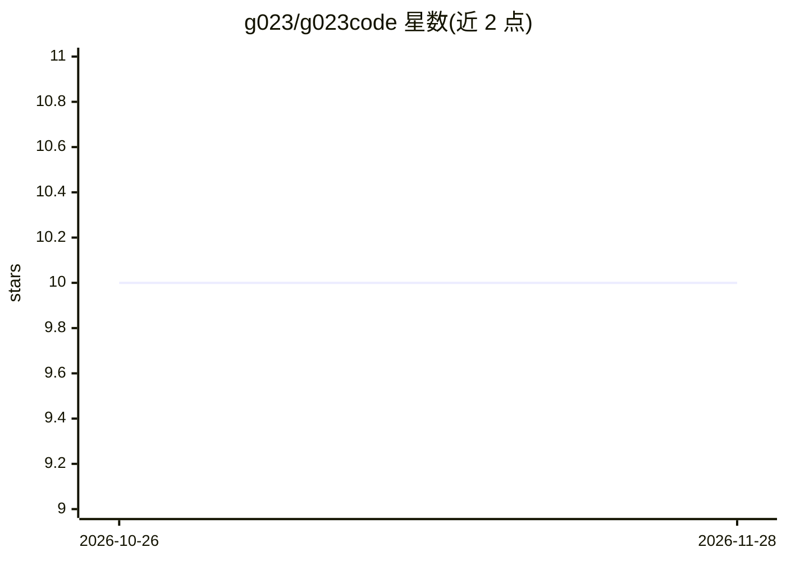

# g023/g023code

⭐ 10 · Python · MIT · 推送 2026-11-12 · [GitHub](https://github.com/g023/g023code) · 个人维护

**终端里的纯 Python AI 编码 agent，围绕 DeepSeek 前缀缓存设计**

面向终端的 AI 编码 agent：读取项目、本地/网页搜索、运行命令、编辑文件并查看图像。默认单 agent（无 subagent 模型调用），FileReader 用本地结构索引与 BM25 解析 focus，数据密集工作走本地 helper 不耗 API 调用。全部请求走 DeepSeek 的 Anthropic 格式单一端点，翻译字节确定性以维持前缀缓存命中；SQLite 缓存重复读取，写/执行操作需用户确认。安装需 Python 3.11+ 与 DeepSeek API key，提供 installer.sh/installer.bat 与手动 pip 路径。

## 筛选速览

| 维度 | 判定 | 备注 |
|---|---|---|
| AI 角色 | `ai-native` | 本体是模型或模型工具 |
| 许可风险 | `permissive` | MIT |
| 部署形态 | `library` | 以包/库形式分发 |
| 模型依赖 | local-ok | 支持本地模型 |
| 硬件要求 | — | 无带数字的原话,不猜 |
| 安装摩擦 | `medium` | 含编译或系统依赖之一 |
| 成熟度 | — | 结构信号不足 |

## 能力要点

- 字节确定性的 Anthropic 编解码，保持 DeepSeek 前缀缓存命中
- 默认单 agent：本地结构索引 + BM25 focus，/subagents on 才启用委托
- 机器级 SQLite 网页缓存与内容哈希缓存，重复操作零 API 调用
- 每次回合显示上下文用量、缓存命中率与本地估算成本

## 适用场景

- 在终端对项目做读码、检索、编辑与命令执行的 AI 辅助开发
- 控制 API 开销：按缓存命中率与逐回合成本透明地使用编码 agent
- 让 agent 通过 WebSearch/Fetch 查询网页并缓存结果复用

## 场景标签

`编码 Agent` · 领域:编码与开发

## 证据(README 行号)

> L3: **A pure-Python AI coding agent for your terminal, powered by DeepSeek V4.1 Flash.**
> L12: g023 Code reads your project, searches it, searches the web, runs commands,
> L18: It works **alone by default**: one orchestrator, no subagent model calls.

## 星数曲线

2026-10-26 10 → 2026-11-28 10（+0）

---
*卡片 v1 · prompt 1.4 · 生成 2026-11-20 · 置信度 high · 依据 README sha `b3de947d9fe7` · [字段定义](../../DATASET.md)*
