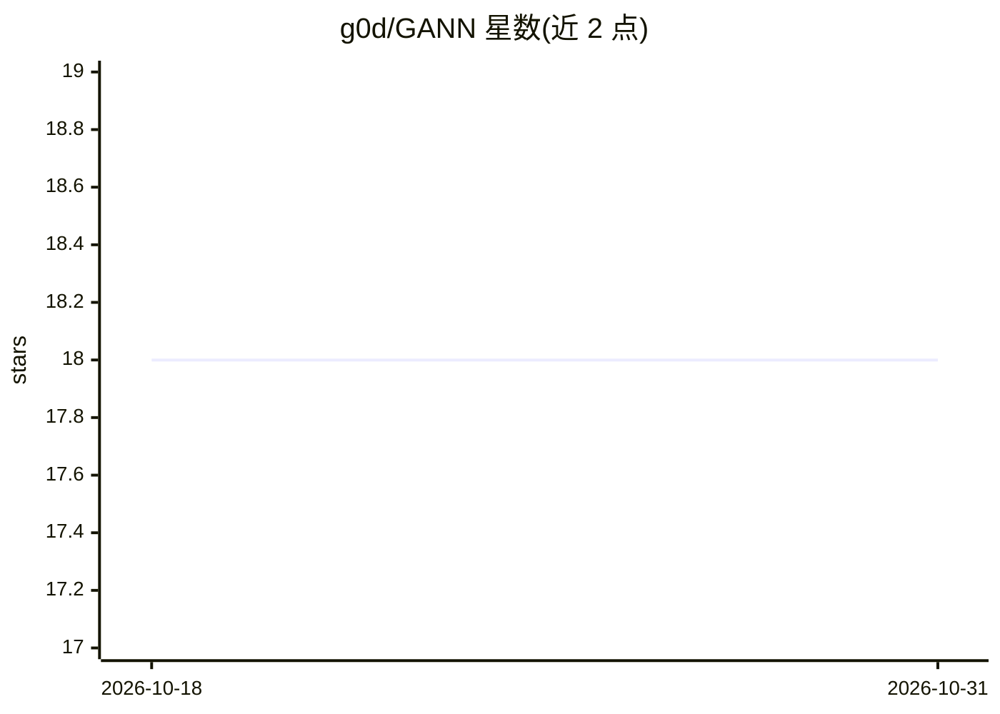

# g0d/GANN

⭐ 18 · C++ · NOASSERTION · 推送 2026-08-30 · [GitHub](https://github.com/g0d/GANN) · 个人维护

**自动创建并训练新型 ANN 的 C/C++ 框架（2006 年提出）**

由 George Delaportas 于 2006 年提出的人工神经网络变体及其配套框架，作者声明其为 NAS、层封装、动态计算图等机制的前身。框架根据特定数学模型与准则自动创建并训练这种新型 ANN，无需编写代码，由 C/C++ 实现。README 未给出安装或运行命令，未列出依赖；采用 BSL-1.1 许可证，并声明以授权方式支持 PROBOTEK 的部分 Vision AI 基础设施。

## 筛选速览

| 维度 | 判定 | 备注 |
|---|---|---|
| AI 角色 | `ai-native` | 本体是模型或模型工具 |
| 许可风险 | `none` | NOASSERTION |
| 部署形态 | `None` |  |
| 模型依赖 | — | README 未给出锁定关系 |
| 硬件要求 | — | 无带数字的原话,不猜 |
| 安装摩擦 | `low` | 无编译、无系统依赖或容器化 |
| 成熟度 | — | 结构信号不足 |

## 能力要点

- 基于特定数学模型自动创建并训练 ANN，声明无需编码
- C/C++ 实现的 ANN 变体（2006 年提出）
- 以授权方式支持 PROBOTEK 的部分 Vision AI 基础设施

## 适用场景

- 研究作者提出的自动拓扑 ANN 方案
- 以 C/C++ 源码方式审阅与实验该框架

## 场景标签

`模型训练` · 领域:训练与推理

## 证据(README 行号)

> L14: Actually, GANN is not just another ANN but rather a framework that creates and trains this new ANN automatically - 
> L5: An alternative kind of ANN introduced by George Delaportas in 2006, that predates most of the innovations recently f

## 星数曲线

2026-10-18 18 → 2026-10-31 18（+0）

---
*卡片 v1 · prompt 1.4 · 生成 2026-10-29 · 置信度 mid · 依据 README sha `2ad0958204d6` · [字段定义](../../DATASET.md)*
