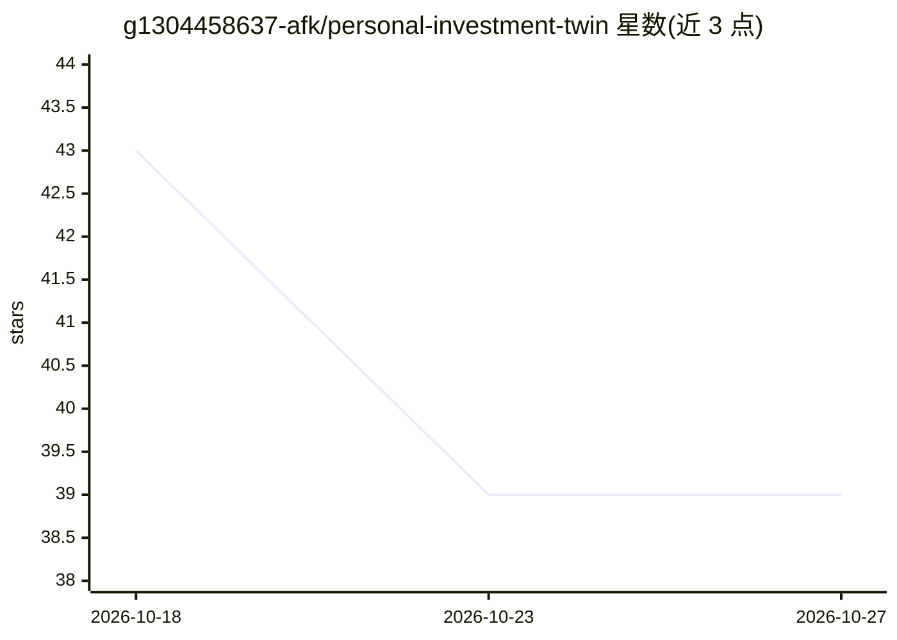

# g1304458637-afk/personal-investment-twin

⭐ 39 · Python · MIT · 推送 2026-10-26 · [GitHub](https://github.com/g1304458637-afk/personal-investment-twin) · 个人维护 · 中文 README

**个人投资者的本地 AI 投资决策教练：复盘历史、归因盈亏**

面向个人投资者的本地优先桌面应用：读取用户自己的交易与持仓历史（支持 Excel/CSV 及东方财富、同花顺导出格式），重建每笔投资 Episode，用 Python 确定性计算做五类决策归因、行为分析与策略回放仿真，并在新交易执行前检索历史相似决策给出提醒。LLM 仅负责理解输入、解释计算结果与个性化对话，不生成任何金融数值；明确不荐股、不预测、不代客交易。架构为 Python 核心引擎 + Tauri 桌面端，通过 PyInstaller sidecar 进程通信，当前支持 macOS Apple Silicon。

## 筛选速览

| 维度 | 判定 | 备注 |
|---|---|---|
| AI 角色 | `ai-enhanced` | 去掉 AI 部分产品仍成立 |
| 许可风险 | `permissive` | MIT |
| 部署形态 | `library` | 以包/库形式分发 |
| 模型依赖 | — | README 未给出锁定关系 |
| 硬件要求 | — | 无带数字的原话,不猜 |
| 安装摩擦 | `low` | 无编译、无系统依赖或容器化 |
| 成熟度 | — | 结构信号不足 |

## 能力要点

- 选股/入场/退出/仓位/摩擦五类决策归因与行为指标分析
- 决策前提醒：检索历史相似决策并用真实结果提示风险
- 策略引擎内置双均线/RSI 均值回归/海龟等规则，可在自有数据上回放对照
- Python 负责全部确定性金融计算，LLM 不允许编造数值；样本不足时输出 Insufficient Evidence

## 适用场景

- 复盘自己的交易历史，弄清每笔盈亏的来源
- 在执行新交易前查看自己历史上相似决策的真实结果
- 在自有数据上回放规则策略并与等权买入持有对照
- 自动识别东方财富/同花顺导出的成交记录并转为标准格式

## 场景标签

`金融量化` · 领域:学习与行业

## 证据(README 行号)

> L5: 投镜（Personal Investment Twin）是一个面向个人投资者的本地优先 AI 投资决策教练。它不荐股、不预测涨跌、不代客交易，而是读取你自己的交易与持仓历史，重建每一笔投资决策过程，用确定性计算解释你为什么赚钱、为什
> L35: - **Python 负责确定性金融计算**；LLM 只负责理解输入、解释计算结果和个性化对话，不允许编造任何金融数值

## 星数曲线

2026-10-18 43 → 2026-10-27 39（-4）

---
*卡片 v1 · prompt 1.4 · 生成 2026-10-25 · 置信度 high · 依据 README sha `e3b62b37ea4b` · [字段定义](../../DATASET.md)*
