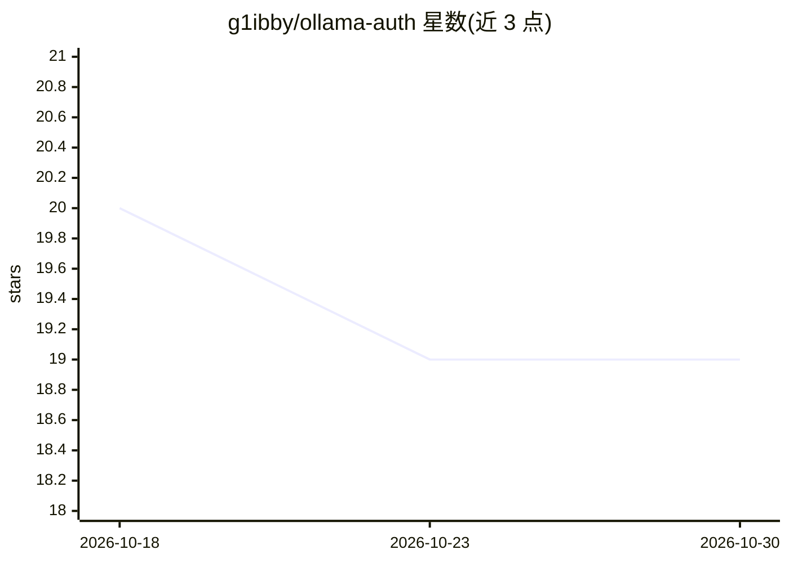

# g1ibby/ollama-auth

⭐ 19 · Shell · MIT · 推送 2025-12-15 · [GitHub](https://github.com/g1ibby/ollama-auth) · 个人维护

**给 Ollama 服务加 API Key 认证的 Docker 镜像**

基于 Caddy 反向代理封装的 Docker 镜像，在 Ollama 服务前增加 API Key 认证层。支持 Bearer Token、Query 参数、X-API-Key 请求头三种认证方式；通过 OLLAMA_API_KEY 环境变量配置密钥，挂载 /root/.ollama 卷持久化模型数据。提供 Docker 与 Docker Compose 两种启动方式，README 附带 OpenWebUI、Ollama CLI、Python 客户端的接入示例及安全建议（密钥轮换、HTTPS、日志监控）。MIT 许可。

## 筛选速览

| 维度 | 判定 | 备注 |
|---|---|---|
| AI 角色 | `ai-ecosystem` | LLM/agent 周边工具 |
| 许可风险 | `permissive` | MIT |
| 部署形态 | `self-host` | docker 或自建部署 |
| 模型依赖 | local-ok | 支持本地模型 |
| 硬件要求 | — | 无带数字的原话,不猜 |
| 安装摩擦 | `low` | 无编译、无系统依赖或容器化 |
| 成熟度 | — | 结构信号不足 |

## 能力要点

- Caddy 反向代理实现的三种认证方式（Bearer/Query/Header）
- 单条 docker run 命令即可启动带认证的 Ollama
- 通过环境变量与卷挂载配置密钥与模型持久化

## 适用场景

- 在内网或公网暴露 Ollama 服务时增加认证保护
- 为 OpenWebUI 等客户端提供带 API Key 的 Ollama 访问入口
- 用 Docker Compose 快速部署受保护的本地模型服务

## 场景标签

 · 领域:LLM 基础设施/代理

## 证据(README 行号)

> L3: A secure Docker image that runs the Ollama service with API key authentication using Caddy as a reverse proxy. This 
> L25: The service supports three authentication methods. Choose the one that best fits your client:

## 星数曲线

2026-10-18 20 → 2026-10-30 19（-1）

---
*卡片 v1 · prompt 1.4 · 生成 2026-10-28 · 置信度 high · 依据 README sha `d8c17906d203` · [字段定义](../../DATASET.md)*
