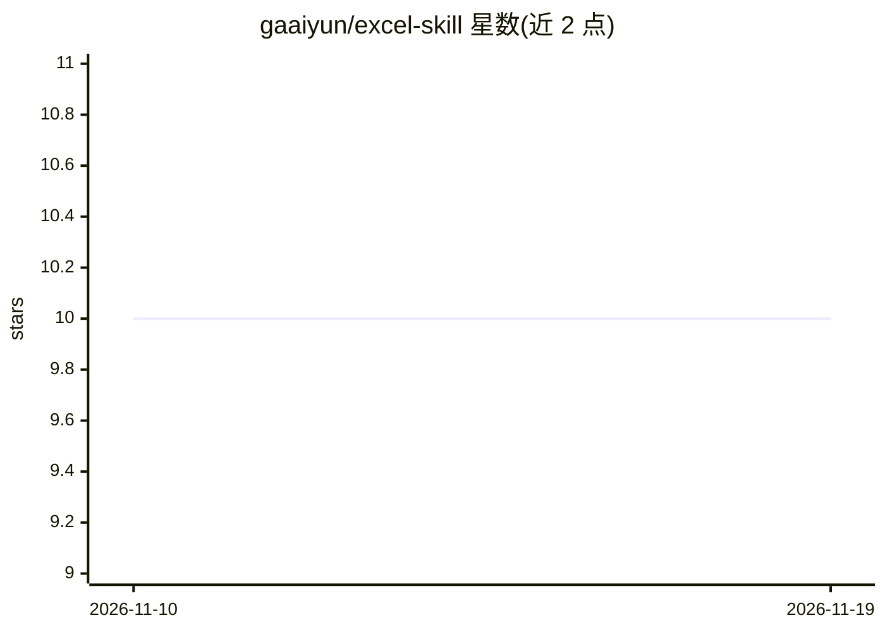

# gaaiyun/excel-skill

⭐ 10 · Python · MIT · 推送 2026-05-31 · [GitHub](https://github.com/gaaiyun/excel-skill) · 个人维护 · 中文 README

**给 AI agent 用的 Excel 模板生成技能包：知识库+行业模板**

面向 Cursor / Claude Code 等 AI agent 的 Excel 技能包，由三部分组成：面向 LLM 的渐进式知识库（公式速查、透视表、Power Query、openpyxl 等 reference 文档，SKILL.md 按问题路由）、5 大行业（金融/快消/电商/互联网/SaaS）的 Python 模板生成器脚本，以及工具脚本（.xlsx 健康度诊断、openpyxl 代码检查、公式重算）。仓库不预存 .xlsx 二进制，跑脚本即生成带公式/样式/图表的文件。中文优先，安装需 git clone 源码并 pip 装依赖；recalc.py 依赖本机 LibreOffice。

## 筛选速览

| 维度 | 判定 | 备注 |
|---|---|---|
| AI 角色 | `ai-knowledge` | 知识聚合/清单类 |
| 许可风险 | `permissive` | MIT |
| 部署形态 | `library` | 以包/库形式分发 |
| 模型依赖 | — | README 未给出锁定关系 |
| 硬件要求 | — | 无带数字的原话,不猜 |
| 安装摩擦 | `low` | 无编译、无系统依赖或容器化 |
| 成熟度 | — | 结构信号不足 |

## 能力要点

- SKILL.md 入口按问题路由到 reference 文档的渐进式知识库
- 5 大行业 Python 生成器脚本按参数产出 .xlsx（不预存二进制）
- analyze.py 对现有 .xlsx 做 10 类健康度诊断（#REF!、整列引用等）
- 中文文档、注释与模板字段

## 适用场景

- 让 AI agent 直接生成金融三表、电商 GMV 仪表盘等行业 Excel 模板
- 审查 AI 生成的 openpyxl 代码是否把公式字符串化
- 给现有 .xlsx 做公式与结构健康度体检

## 场景标签

 · 领域:办公自动化/Excel 模板生成

## 证据(README 行号)

> L3: > 给 AI agent 用的 Excel 工具包：结构化知识库 + 5 大行业模板生成器 + 健康度诊断 + Python 自动化脚本。
> L34: 这个项目就是给 AI 一份**结构化知识库 + 行业模板库 + 一组可复用脚本**，让它一次给对。
> L88: ### 1. AI 友好的 Excel 知识库（progressive disclosure）

## 星数曲线

2026-11-10 10 → 2026-11-19 10（+0）

---
*卡片 v1 · prompt 1.4 · 生成 2026-11-19 · 置信度 high · 依据 README sha `78cf60c16cce` · [字段定义](../../DATASET.md)*
