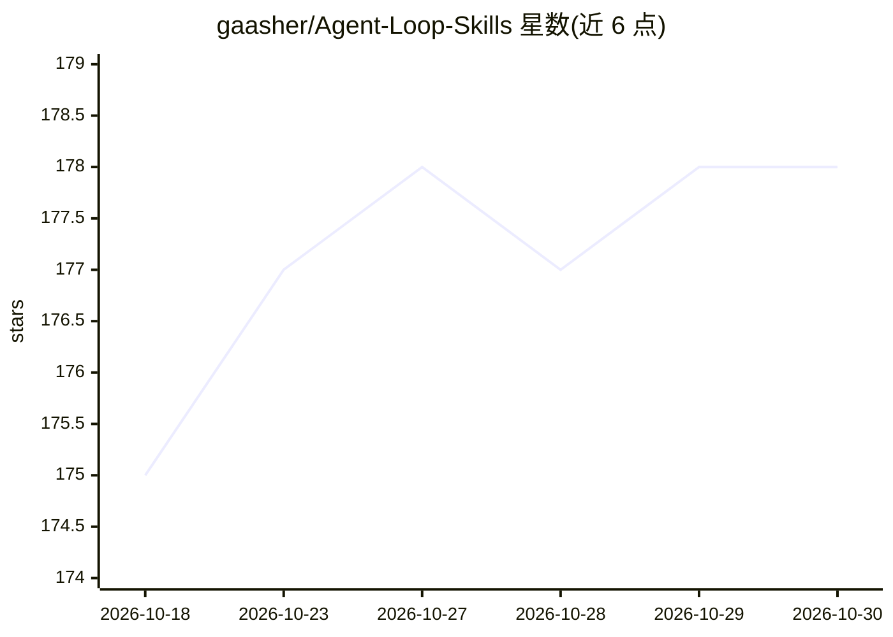

# gaasher/Agent-Loop-Skills

⭐ 178 · Python · MIT · 推送 2026-06-30 · [GitHub](https://github.com/gaasher/Agent-Loop-Skills) · 个人维护

**开发者用的可复用 agentic 循环技能包（自动科研/写作/优化/红队）**

以开放标准 Agent Skills（SKILL.md）形式交付的一组通用 agentic 循环：自动 ML 科研、科学写作、数据分析、代码/SQL/prompt 优化、红蓝紫队测试、假设生成与功效分析等。每个循环在调用时绑定用户自己的任务与环境，按真实反馈信号（测试、延迟、指标、校准判官）迭代并仅保留改进，含显式终止条件与运行台账。技能零重依赖，用户代码在自身环境运行。原生支持 Claude Code 插件市场安装，也经 npx skills add / gh skill / 手动复制用于 Codex、Cursor 等约 30 个 Skills 宿主；多角色循环派发子代理仅在 Claude Code 上确认可用，其他宿主以串行内联方式运行。

## 筛选速览

| 维度 | 判定 | 备注 |
|---|---|---|
| AI 角色 | `ai-ecosystem` | LLM/agent 周边工具 |
| 许可风险 | `permissive` | MIT |
| 部署形态 | `library` | 以包/库形式分发 |
| 模型依赖 | — | README 未给出锁定关系 |
| 硬件要求 | — | 无带数字的原话,不猜 |
| 安装摩擦 | `low` | 无编译、无系统依赖或容器化 |
| 成熟度 | `idea` | |

## 能力要点

- 每循环绑定任务后按真实反馈信号迭代，仅保留改进并记录台账
- 以开放标准 SKILL.md 交付，覆盖 Claude Code、Codex、Cursor 等约 30 个宿主
- 技能本身零重依赖，用户代码在自身环境执行
- 提供自动科研、科学写作、数据分析、代码/SQL 优化、红蓝紫队等 20+ 循环

## 适用场景

- 让 agent 循环迭代改进我的 ML 实验或模型指标
- 对论文草稿、图表做带评审循环的科学写作打磨
- 用红队/紫队循环测试自有系统的安全弱点
- 以测试与延迟为门槛优化代码或 SQL

## 场景标签

`数据分析` `科研工具` `网络安全` · 领域:效率与自动化

## 证据(README 行号)

> L3: ### Loop until it's better — drop-in agentic **loops**, packaged as open-standard **Agent Skills**.
> L30:  (Simon Willison). One `SKILL.md` now runs across
> L31:  ~30 hosts (Claude Code, Codex, Cursor, …).

## 星数曲线

2026-10-18 175 → 2026-10-30 178（+3）

---
*卡片 v1 · prompt 1.4 · 生成 2026-10-22 · 置信度 high · 依据 README sha `4246ed674ba5` · [字段定义](../../DATASET.md)*
