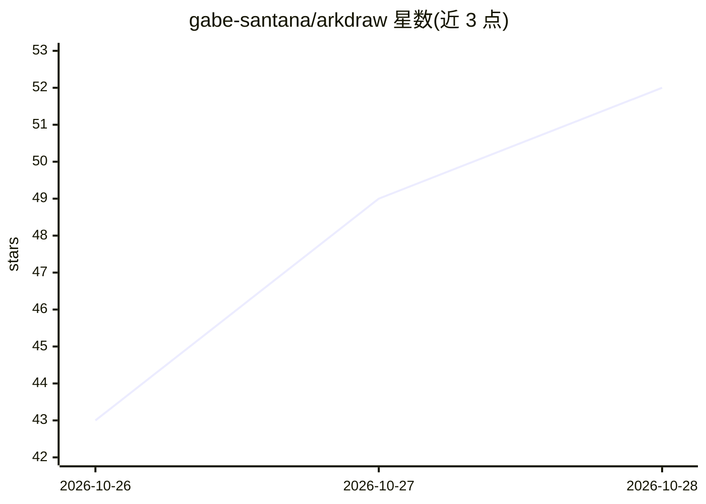

# gabe-santana/arkdraw

⭐ 52 · TypeScript · MIT · 推送 2026-10-25 · [GitHub](https://github.com/gabe-santana/arkdraw) · [官网](https://arkdraw.com/) · 个人维护

**带 AI 助手的本地优先开源图表编辑器**

开源图表编辑器，支持流程图、UML、ER 图、网络图、线框图与思维导图，可读写 .drawio/.vsdx，导入 Mermaid、Graphviz、CSV、SQL，文件为 git 可 diff 的 .arkdraw JSON，本地优先、离线可用。AI 助手通过自然语言生成与编辑图表：使用官方 AWS/Azure/GCP/Oracle/Kubernetes 图标、自动布局连线、可生成动画并导出 GIF；支持 Claude/OpenAI/Gemini/DeepSeek/Ollama 等多家模型或本地离线推理。提供 Windows/macOS/Linux 桌面安装包与网页版，密钥存于系统钥匙串。

## 筛选速览

| 维度 | 判定 | 备注 |
|---|---|---|
| AI 角色 | `ai-enhanced` | 去掉 AI 部分产品仍成立 |
| 许可风险 | `permissive` | MIT |
| 部署形态 | `desktop` | 安装包/桌面程序 |
| 模型依赖 | local-ok | 支持本地模型 |
| 硬件要求 | — | 无带数字的原话,不猜 |
| 安装摩擦 | `low` | 无编译、无系统依赖或容器化 |
| 成熟度 | — | 结构信号不足 |

## 能力要点

- 自然语言生成/编辑原生形状图表，非图片输出
- 支持 Anthropic/OpenAI/Gemini/Ollama 等多家模型，密钥存本地钥匙串
- 官方云厂商图标（AWS/Azure/GCP/Oracle/K8s），连线自动路由避让
- 本地优先 .arkdraw JSON 格式，git 可 diff，兼容 .drawio/.vsdx

## 适用场景

- 用自然语言快速生成云架构图和流程图
- 在现有图表上用对话式指令增删节点与动画
- 离线或自托管环境下绘制和编辑架构图

## 场景标签

 · 领域:图形/图表工具

## 证据(README 行号)

> L9:  An open-source diagram editor with an AI assistant that draws, edits and animates real architecture diagrams,
> L62: - **Local-first.** `.arkdraw` is plain JSON that diffs in git. No account, works offline.

## 星数曲线

2026-10-26 43 → 2026-10-28 52（+9）

---
*卡片 v1 · prompt 1.4 · 生成 2026-10-25 · 置信度 high · 依据 README sha `51841744415f` · [字段定义](../../DATASET.md)*
