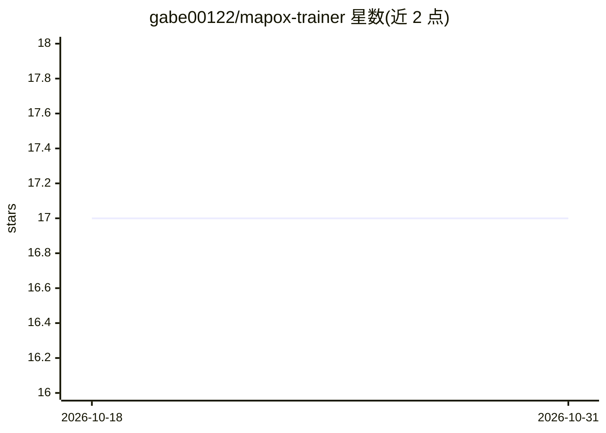

# gabe00122/mapox-trainer

⭐ 17 · Python · 推送 2026-10-22 · [GitHub](https://github.com/gabe00122/mapox-trainer) · 个人维护

**JAX 多智能体强化学习训练框架：Transformer 智能体+PPO**

基于 JAX/Flax 的部分可观测多智能体强化学习（MARL）训练框架：使用带 RoPE 与 pre-layer norm 的 Transformer-over-time 架构处理记忆与部分可观测性，提供 PPO 实现、多任务训练（任务 ID 嵌入）、Snapshot League 自博弈与 TrueSkill 评测。内置 Grid Return、Scouts、旅行商、King of the Hill 等自研网格环境（已抽出为独立 mapox 包），并支持 Craftax。通过 uv 安装，提供 CLI（pmarl）训练/回放/评测，支持导出 WebAssembly 在浏览器运行策略，可从 Hugging Face 下载预训练 multitask 模型。

## 筛选速览

| 维度 | 判定 | 备注 |
|---|---|---|
| AI 角色 | `ai-native` | 本体是模型或模型工具 |
| 许可风险 | `none` | — |
| 部署形态 | `None` |  |
| 模型依赖 | — | README 未给出锁定关系 |
| 硬件要求 | — | 无带数字的原话,不猜 |
| 安装摩擦 | `medium` | 含编译或系统依赖之一 |
| 成熟度 | — | 结构信号不足 |

## 能力要点

- Transformer 智能体 + PPO，含分组查询注意力与 bfloat16 训练
- 多任务训练：单模型经任务 ID 嵌入同时在多环境训练
- Snapshot League 自博弈与 TrueSkill 零和博弈评测
- 策略可导出 WebAssembly 在浏览器中运行查看

## 适用场景

- 在部分可观测多智能体环境中训练带记忆的策略
- 研究多任务与自博弈对训练效果的影响
- 用 TrueSkill 对比不同训练轮次的策略强度
- 下载预训练模型直接回放或在浏览器查看智能体行为

## 场景标签

`强化学习` `多智能体` · 领域:Agent 开发

## 证据(README 行号)

> L3: This project provides a JAX-based framework for training Transformer-based agents in custom, partially observable mu
> L13: * **Transformer-based Agents**: Uses a Transformer-over-time architecture to handle partial observability. Uses upd
> L16: * **PPO Implementation**: A clean and efficient Proximal Policy Optimization (PPO) implementation.

## 星数曲线

2026-10-18 17 → 2026-10-31 17（+0）

---
*卡片 v1 · prompt 1.4 · 生成 2026-10-29 · 置信度 high · 依据 README sha `98b3f8ec1668` · [字段定义](../../DATASET.md)*
