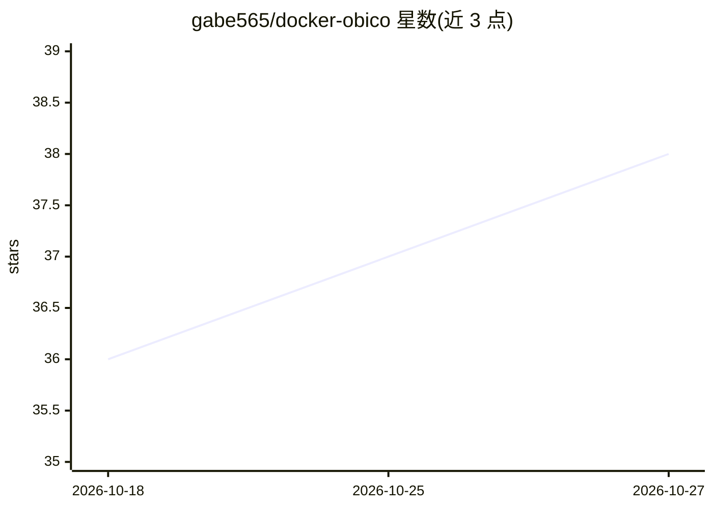

# gabe565/docker-obico

⭐ 38 · 推送 2026-10-23 · [GitHub](https://github.com/gabe565/docker-obico) · [官网](https://obico.io) · 个人维护

**为 Obico 服务器提供预构建 Docker 镜像，便于在不支持本地构建的托管环境部署**

为 TheSpaghettiDetective/obico-server 构建并发布 Docker 镜像（web 与 ml-api 两个镜像），面向不支持本地构建镜像的托管环境。Obico 的 git ref 由 Renovate bot 自动更新，新版本发布后数小时内可用。web 镜像将前端文件直接构建进容器，无需在 /frontend 挂载卷。部署方式为复制 .env.example 配置后 docker compose up，Web UI 默认在 localhost:3334，数据存于 data 目录；另提供 Kubernetes Helm chart。

## 筛选速览

| 维度 | 判定 | 备注 |
|---|---|---|
| AI 角色 | `ai-ecosystem` | LLM/agent 周边工具 |
| 许可风险 | `none` | — |
| 部署形态 | `self-host` | docker 或自建部署 |
| 模型依赖 | — | README 未给出锁定关系 |
| 硬件要求 | — | 无带数字的原话,不猜 |
| 安装摩擦 | `low` | 无编译、无系统依赖或容器化 |
| 成熟度 | — | 结构信号不足 |

## 能力要点

- 发布 web 与 ml-api 两个预构建镜像到 ghcr.io
- Renovate bot 自动跟踪 Obico 上游版本
- 前端文件内置，无需 /frontend 卷挂载
- 提供 Kubernetes Helm chart

## 适用场景

- 在无法本地构建镜像的托管平台上运行 Obico
- 通过 docker compose 快速部署 Obico 服务
- 在 Kubernetes 集群中以 Helm chart 部署

## 场景标签

 · 领域:3D 打印/自托管部署

## 证据(README 行号)

> L5: This repo builds Docker images for TheSpaghettiDetective/obico-server to be used in hosting environments that do not
> L11: - ghcr.io/gabe565/obico/web
> L12: - ghcr.io/gabe565/obico/ml-api

## 星数曲线

2026-10-18 36 → 2026-10-27 38（+2）

---
*卡片 v1 · prompt 1.4 · 生成 2026-10-25 · 置信度 high · 依据 README sha `5933e0a9826b` · [字段定义](../../DATASET.md)*
