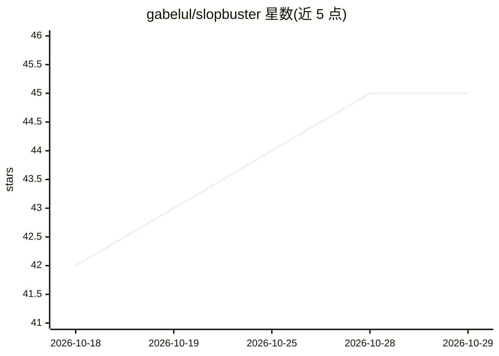

# gabelul/slopbuster

⭐ 45 · MIT · 推送 2026-07-21 · [GitHub](https://github.com/gabelul/slopbuster) · 个人维护

**移除文本/代码/学术写作中 AI 特征的 markdown agent 技能**

以纯 markdown 规则集形式发布的 agent 技能：由 152 个模式（文本 24、代码 79、学术 49）构成，来源为 1,000+ AI 与人类样本分析及同行评审 LLM 检测研究。工作方式为两遍重写（第一遍去除模式、第二遍加入语气），配三级加权评分（0-10 人性化量表）与 FLAGS FOR MANUAL REVIEW 缺证据标记。无独立运行时与 API key，运行在用户已有的 agent 与模型上；支持 Claude Code、Codex CLI、Cursor 等 40+ agent 安装。限制：sentence-length variance 指标在示例中未起区分作用（README 自述）。

## 筛选速览

| 维度 | 判定 | 备注 |
|---|---|---|
| AI 角色 | `ai-ecosystem` | LLM/agent 周边工具 |
| 许可风险 | `permissive` | MIT |
| 部署形态 | `library` | 以包/库形式分发 |
| 模型依赖 | — | README 未给出锁定关系 |
| 硬件要求 | — | 无带数字的原话,不猜 |
| 安装摩擦 | `low` | 无编译、无系统依赖或容器化 |
| 成熟度 | — | 结构信号不足 |

## 能力要点

- 152 个模式覆盖文本/代码/学术三类写作
- 两遍重写流程：去除 AI 模式后再加入语气
- 三级加权评分与 0-10 人性化量表
- 纯 markdown 实现，无 API key、无独立运行时

## 适用场景

- 让 agent 重写营销文案或博客，去除 AI 痕迹
- 扫描源代码中的 AI 生成代码特征
- 按学科领域调整学术论文章节中的 AI 写作模式
- 仅评分不重写，检查稿件是否像 AI 生成

## 场景标签

`AI 写作` · 领域:内容生成

## 证据(README 行号)

> L72: **No API key, no second bill, nothing to install.** slopbuster is pure markdown
> L177: slopbuster is markdown, so it works anywhere an agent can read a skill file.
> L182: |Claude Code|`npx skills add`|`/slopbuster`|Primary target — developed and tested here|

## 星数曲线

2026-10-18 42 → 2026-10-29 45（+3）

---
*卡片 v1 · prompt 1.4 · 生成 2026-10-25 · 置信度 high · 依据 README sha `9269c7070005` · [字段定义](../../DATASET.md)*
