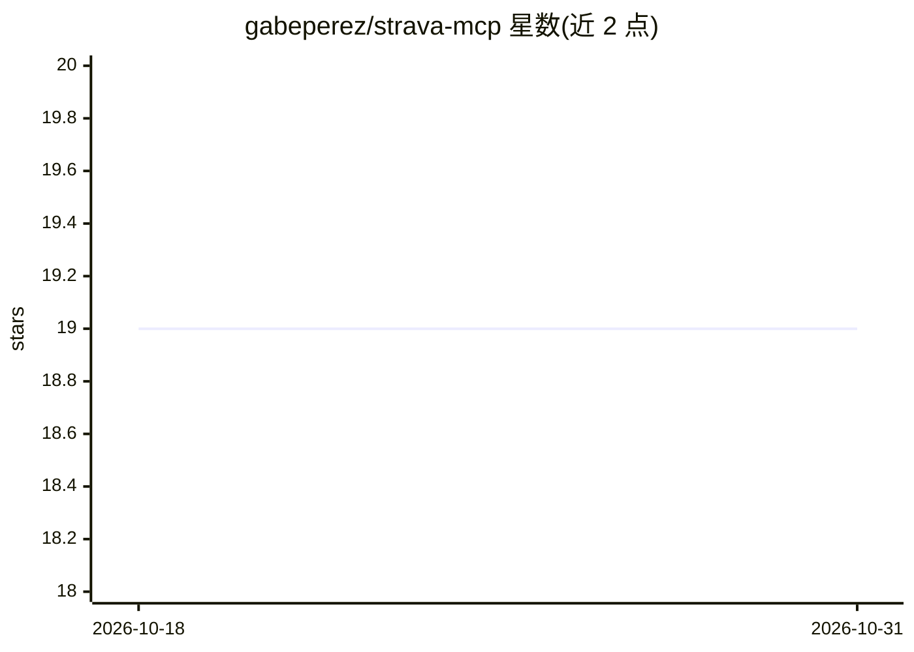

# gabeperez/strava-mcp

⭐ 19 · TypeScript · MIT · 推送 2026-04-04 · [GitHub](https://github.com/gabeperez/strava-mcp) · [官网](https://sportmcp.mainichi.fit/) · 个人维护

**部署在 Cloudflare Workers 的 Strava 个人数据 MCP 服务器**

面向个人用户的 Model Context Protocol 服务器：部署一次到 Cloudflare Workers，通过 Strava OAuth 2.0 授权后，生成个人 MCP URL 供 Claude Desktop、Cursor、Windsurf、Cline、Continue.dev、Poke 等 MCP 客户端接入，以只读方式查询活动、圈数、片段、装备、俱乐部等 21 个工具覆盖的健身数据。提供带统计面板的 Web Dashboard、自动令牌刷新与可选的 Poke 实时 webhook 通知；支持 Streamable HTTP 与 HTTP+SSE 两种传输。运行于 Cloudflare 免费额度，需 Node.js 18+ 与 Strava API 应用。

## 筛选速览

| 维度 | 判定 | 备注 |
|---|---|---|
| AI 角色 | `ai-ecosystem` | LLM/agent 周边工具 |
| 许可风险 | `permissive` | MIT |
| 部署形态 | `library` | 以包/库形式分发 |
| 模型依赖 | — | README 未给出锁定关系 |
| 硬件要求 | — | 无带数字的原话,不猜 |
| 安装摩擦 | `low` | 无编译、无系统依赖或容器化 |
| 成熟度 | — | 结构信号不足 |

## 能力要点

- 21 个 MCP 工具覆盖活动、运动员、片段、装备与社交数据
- 标准 Strava OAuth 2.0 授权，按用户隔离令牌并自动刷新
- 个人 Dashboard 展示活动统计并生成各 AI 客户端配置片段
- 可选 Poke webhook 在训练完成后推送通知

## 适用场景

- 让我在 Claude Desktop 或 Cursor 中用自然语言查询自己的 Strava 训练数据
- 免费额度内自部署一个只读的 Strava 数据接入端点
- 训练完成后通过手机收到实时推送通知

## 场景标签

`数据分析` · 领域:效率与自动化

## 证据(README 行号)

> L3: > **Production-ready MCP server** for Strava — works with Claude Desktop, Cursor, Windsurf, Cline, Continue.dev, Pok
> L13: A complete **Model Context Protocol server** that gives any AI assistant secure, read-only access to your personal 
> L128: SportMCP uses the standard **Model Context Protocol**, so it works with any MCP-compatible client. Your personal U

## 星数曲线

2026-10-18 19 → 2026-10-31 19（+0）

---
*卡片 v1 · prompt 1.4 · 生成 2026-10-28 · 置信度 high · 依据 README sha `0a80630b996e` · [字段定义](../../DATASET.md)*
