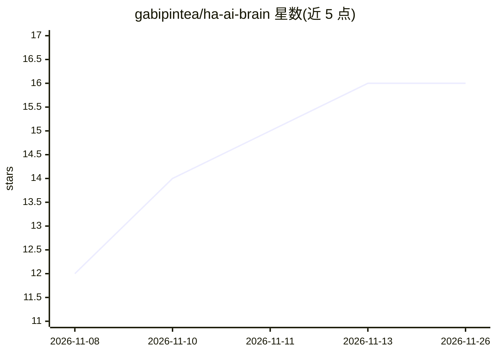

# gabipintea/ha-ai-brain

⭐ 16 · Python · MIT · 推送 2026-11-19 · [GitHub](https://github.com/gabipintea/ha-ai-brain) · [官网](https://github.com/gabipintea/ha-ai-brain) · 个人维护

**Home Assistant 的自学习自动化大脑：本地习惯挖掘 + 多智能体 LLM 辅助**

以 Home Assistant Add-on 形式运行的后台服务：自动发现实体并导入历史，用本地统计（不消耗 AI token）挖掘重复习惯、学习各时段正常范围，并将强习惯回测后转为原生 Home Assistant 自动化；同时输出异常告警（破坏的例程、传感器离线、状态过久等）。AI 部分为按需调用的专项智能体（气候/照明/安防/能源等），经沙箱计算并受硬性护栏、审批与 token 预算约束；支持 Gemini、OpenAI、Anthropic、OpenRouter 及本地 Ollama，全程可仅本地运行。

## 筛选速览

| 维度 | 判定 | 备注 |
|---|---|---|
| AI 角色 | `ai-enhanced` | 去掉 AI 部分产品仍成立 |
| 许可风险 | `permissive` | MIT |
| 部署形态 | `None` |  |
| 模型依赖 | local-ok | 支持本地模型 |
| 硬件要求 | — | 无带数字的原话,不猜 |
| 安装摩擦 | `low` | 无编译、无系统依赖或容器化 |
| 成熟度 | — | 结构信号不足 |

## 能力要点

- 零 token 的本地习惯挖掘与回测，产出原生 HA 自动化
- 习惯/异常检测与 Watches 运行不依赖任何 AI 调用
- 专项智能体（气候/照明/安防/能源/遮阳/诊断）+ 自定义 agent
- Shadow/Co-pilot/Autonomous 三级自治与硬性安全护栏、Undo
- 多提供商支持含本地 Ollama，隐私过滤隐藏人员与网络标识

## 适用场景

- 让家里重复出现的习惯自动变成可回测验证的 HA 自动化
- 传感器离线、状态异常、例程被破坏时收到本地免费告警
- 用一句话描述自动化或告警条件，由 AI 生成并本地运行
- 树莓派上低成本运行带 AI 智能体的家庭管家

## 场景标签

`多智能体` `工作流自动化` · 领域:Agent 开发

## 证据(README 行号)

> L23: * Turns strong, un-automated habits into **native Home Assistant automations** — written by statistics, not by an A
> L86: **Does it need a cloud AI?** No. With a local Ollama model nothing leaves your network. Habit detection, backtestin

## 星数曲线

2026-11-08 12 → 2026-11-26 16（+4）

---
*卡片 v1 · prompt 1.4 · 生成 2026-11-18 · 置信度 high · 依据 README sha `b902a48de9ab` · [字段定义](../../DATASET.md)*
