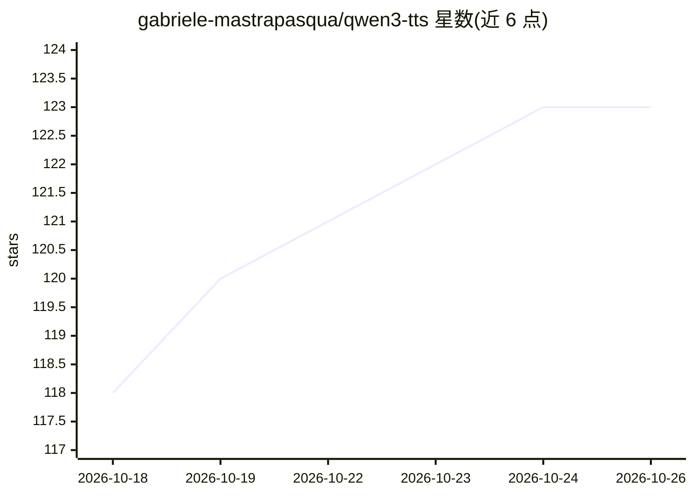

# gabriele-mastrapasqua/qwen3-tts

⭐ 123 · C · MIT · 推送 2026-09-25 · [GitHub](https://github.com/gabriele-mastrapasqua/qwen3-tts) · 个人维护

**纯 C 实现的 Qwen3-TTS 推理引擎，CPU 上跑文本转语音**

轻量跨平台 C 推理引擎，运行 Qwen3-TTS 0.6B/1.7B 文本转语音模型的完整流水线：BPE 分词、28 层因果 Transformer、多趟码预测器与卷积语音解码器，权重从 safetensors 以 BF16 内存映射加载。仅依赖 C 编译器与 BLAS，支持 macOS/Linux/Windows/WSL2（ARM/x86），可选 Metal/CUDA GPU 后端。提供 9 个预设音色、10 种语言、短 WAV 音色克隆、情绪/风格控制、INT8/INT4 量化、流式输出与 OpenAI 兼容 HTTP 服务。情绪功能自标 Beta。面向具备编译能力的开发者，通过源码编译安装。

## 筛选速览

| 维度 | 判定 | 备注 |
|---|---|---|
| AI 角色 | `ai-native` | 本体是模型或模型工具 |
| 许可风险 | `permissive` | MIT |
| 部署形态 | `None` |  |
| 模型依赖 | — | README 未给出锁定关系 |
| 硬件要求 | — | 无带数字的原话,不猜 |
| 安装摩擦 | `medium` | 含编译或系统依赖之一 |
| 成熟度 | `idea` | |

## 能力要点

- 纯 C + BLAS 实现完整 TTS 流水线，无 Python/PyTorch 依赖
- 从短 WAV 克隆音色并可保存为约 25 MB 的 .qvoice 便携档案
- INT8/INT4 量化，Apple Silicon 上 0.6B 达到亚实时（RTF 0.52）
- HTTP 服务支持 OpenAI 兼容 /v1/audio/speech 与流式输出

## 适用场景

- 在本地 CPU 或 GPU 上离线运行 Qwen3-TTS 做文本转语音
- 用参考音频克隆音色并叠加情绪生成有声书/配音
- 通过 OpenAI 兼容接口把 TTS 能力接入现有应用

## 场景标签

`语音合成` `推理引擎` · 领域:内容生成

## 证据(README 行号)

> L7: A lightweight, cross-platform C inference engine for Qwen3-TTS text-to-speech models (0.6B and 1.7B). No Python, no 
> L9: The engine runs the complete TTS pipeline: BPE tokenization, a 28-layer causal transformer (Talker), a multi-pass co

## 星数曲线

2026-10-18 118 → 2026-10-26 123（+5）

---
*卡片 v1 · prompt 1.4 · 生成 2026-10-23 · 置信度 high · 依据 README sha `37c3a89fec3e` · [字段定义](../../DATASET.md)*
