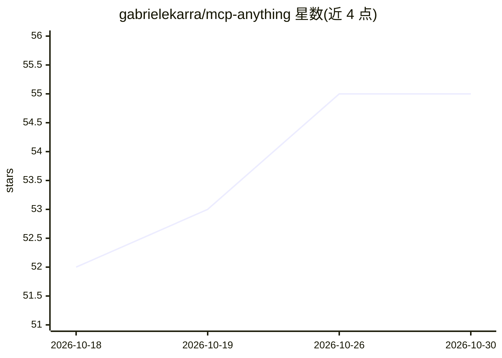

# gabrielekarra/mcp-anything

⭐ 55 · Python · Apache-2.0 · 推送 2026-09-13 · [GitHub](https://github.com/gabrielekarra/mcp-anything) · 个人维护

**把代码库/API 规格一句话生成为可用 MCP 服务器**

CLI 工具，通过自然语言 brief 或静态扫描代码库、OpenAPI/GraphQL/gRPC 规格生成完整 MCP 服务器包。两种模式：build 由 LLM 读取 brief 设计分组工具，generate 做静态检测无需 LLM。支持 27 种源类型、8 个生态（Python/Java/Go/Rust 等），输出 pip 可安装包（FastMCP 默认）或 TypeScript（mcp-use），含 SKILL.md 与 eval harness，支持 stdio/HTTP 传输。build 模式需 ANTHROPIC_API_KEY。

## 筛选速览

| 维度 | 判定 | 备注 |
|---|---|---|
| AI 角色 | `ai-ecosystem` | LLM/agent 周边工具 |
| 许可风险 | `permissive` | Apache-2.0 |
| 部署形态 | `library` | 以包/库形式分发 |
| 模型依赖 | — | README 未给出锁定关系 |
| 硬件要求 | — | 无带数字的原话,不猜 |
| 安装摩擦 | `low` | 无编译、无系统依赖或容器化 |
| 成熟度 | — | 结构信号不足 |

## 能力要点

- brief 驱动与静态扫描两种生成模式
- 支持 27 种源类型（Flask/FastAPI/Spring Boot/OpenAPI/gRPC 等）
- 生成含 SKILL.md、eval harness 的 pip 可安装包
- 输出 FastMCP（Python）或 mcp-use（TypeScript）两种目标

## 适用场景

- 把现有 Web 服务快速包装成 MCP 工具供 agent 调用
- 从 OpenAPI/gRPC/GraphQL 规格批量生成 MCP 服务器
- 在 Claude Code 内直接用自然语言指令生成服务器

## 场景标签

`代码生成` · 领域:编码与开发

## 证据(README 行号)

> L12: MCP-Anything turns any data source into a fully implemented MCP server — from a plain-language brief describing wha
> L69: ### `build` — brief-driven (recommended)
> L194: ## Framework support (generate mode)

## 星数曲线

2026-10-18 52 → 2026-10-30 55（+3）

---
*卡片 v1 · prompt 1.4 · 生成 2026-10-24 · 置信度 mid · 依据 README sha `dbf4b73c51ce` · [字段定义](../../DATASET.md)*
