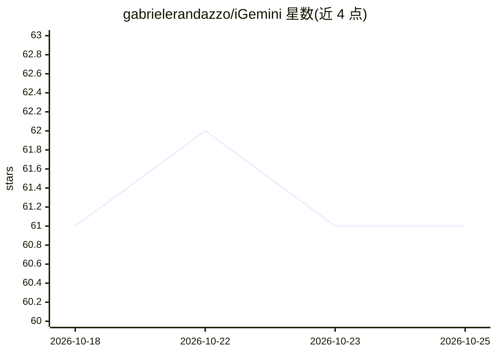

# gabrielerandazzo/iGemini

⭐ 61 · MIT · 推送 2026-07-28 · [GitHub](https://github.com/gabrielerandazzo/iGemini) · 个人维护

**在 Apple 生态调用 Google Gemini 的快捷指令（Shortcuts）**

一个 Apple Shortcut 文件，把用户输入（文本、链接、网页、PDF、图片、截图）发送到 Google Gemini API 并返回回答。可通过 Siri、Share Sheet、Shortcuts 应用或 Apple Watch 触发，支持 iOS/iPadOS/macOS/watchOS。安装方式为下载 shortcut 文件导入 Shortcuts 应用并填入自备的 Gemini API key。默认模型 gemini-flash-latest，支持多轮对话与四种界面语言。限制：API key 以明文存储在快捷指令变量中，未加密。

## 筛选速览

| 维度 | 判定 | 备注 |
|---|---|---|
| AI 角色 | `ai-native` | 本体是模型或模型工具 |
| 许可风险 | `permissive` | MIT |
| 部署形态 | `None` |  |
| 模型依赖 | — | README 未给出锁定关系 |
| 硬件要求 | — | 无带数字的原话,不猜 |
| 安装摩擦 | `low` | 无编译、无系统依赖或容器化 |
| 成熟度 | — | 结构信号不足 |

## 能力要点

- 自动识别输入类型（文本/链接/网页/PDF/图片）并适配请求
- 支持 Siri、Share Sheet、Apple Watch、macOS 菜单栏/快捷键触发
- 多轮对话，会话上下文本地保存
- 语音指令触发实时截图并发送给 Gemini 做视觉分析

## 适用场景

- 在 iPhone/iPad 上通过分享菜单让 Gemini 总结网页或 PDF
- 对着 Siri 或 Apple Watch 提问获取 Gemini 回答
- 截图后让 Gemini 解释屏幕上的错误或界面

## 场景标签

`AI 助手` · 领域:对话与助手

## 证据(README 行号)

> L2: A powerful Apple Shortcut to seamlessly integrate Google Gemini across your entire Apple ecosystem: iOS, iPadOS, mac
> L46: 3. Gemini will generate a response instantly.

## 星数曲线

2026-10-18 61 → 2026-10-25 61（+0）

---
*卡片 v1 · prompt 1.4 · 生成 2026-10-24 · 置信度 high · 依据 README sha `6145ece87785` · [字段定义](../../DATASET.md)*
