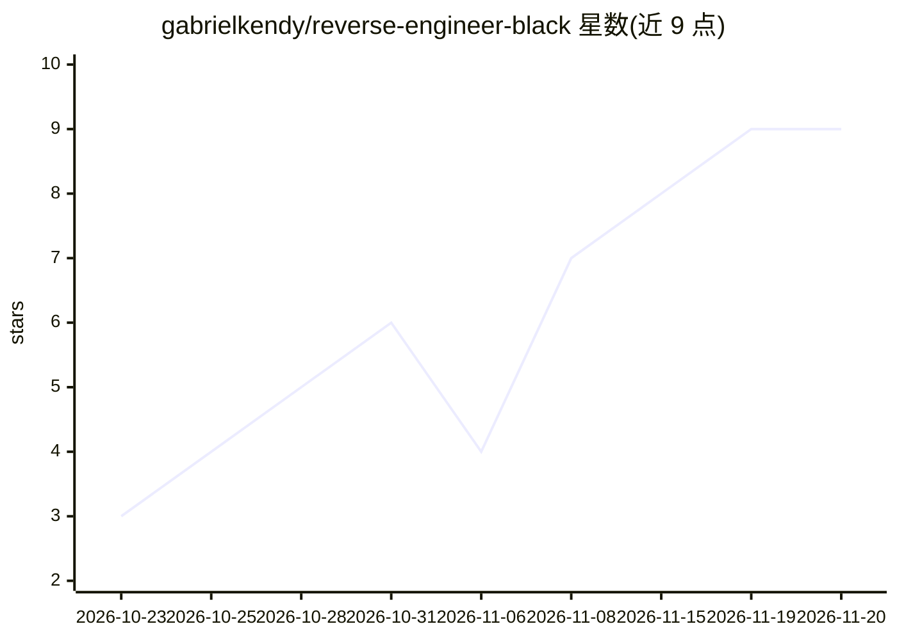

# gabrielkendy/reverse-engineer-black

⭐ 9 · Python · MIT · 推送 2026-10-14 · [GitHub](https://github.com/gabrielkendy/reverse-engineer-black) · [官网](https://agenciabase.tech) · 个人维护

**让 AI 代理自主执行应用逆向工程的方法与提示词套件**

一个方法仓库而非代码工程：提供两套提示词 kit（本地应用逆向、SaaS thin-client 逆向）与 12 阶段流程、交付校验脚本 VALIDAR-KIT.py，以及 SEM-TRAVA 门控与 EXECUTAR-TUDO 消息用于防止代理中途停止。用户给出应用名与本地路径，配合支持 shell 执行的代理（Claude Code、Codex、Cursor、Hermes 等）粘贴提示词后由代理自行执行识别、解包、反编译、重建与验证。面向需要理解应用内部结构并进行学习、迁移、审计的用户；仓库声明不含第三方项目与二进制。

## 筛选速览

| 维度 | 判定 | 备注 |
|---|---|---|
| AI 角色 | `ai-knowledge` | 知识聚合/清单类 |
| 许可风险 | `permissive` | MIT |
| 部署形态 | `None` |  |
| 模型依赖 | — | README 未给出锁定关系 |
| 硬件要求 | — | 无带数字的原话,不猜 |
| 安装摩擦 | `low` | 无编译、无系统依赖或容器化 |
| 成熟度 | — | 结构信号不足 |

## 能力要点

- 两个 kit：本地应用（exe/dll/asar/apk/jar/.NET）与 SaaS thin-client 逆向
- SEM-TRAVA 门控与 EXECUTAR-TUDO 消息，驱动代理连续执行 12 阶段
- VALIDAR-KIT.py 校验脚本对两个 kit 输出 0-100% 完整度评分
- 以 Claude Code skill/command（/er-black）形式提供安装入口

## 适用场景

- 用 AI 代理对自有应用做逆向学习与迁移
- 审计自己写的软件并重建丢失的源码
- 教学与咨询场景演示应用内部结构

## 场景标签

`提示工程` `网络安全` · 领域:Agent 开发

## 证据(README 行号)

> L3: O método completo de engenharia reversa, empacotado para o seu agente de IA executar sozinho.
> L27: **O que é.** Um repositório de método, não de código alheio. Dentro dele estão os dois kits de
> L42: **O que você precisa ter.** Um agente de IA com execução de shell (Claude Code, Codex, Cursor,

## 星数曲线

2026-10-23 3 → 2026-11-20 9（+6）

---
*卡片 v1 · prompt 1.4 · 生成 2026-11-20 · 置信度 mid · 依据 README sha `9de63b9586e6` · [字段定义](../../DATASET.md)*
