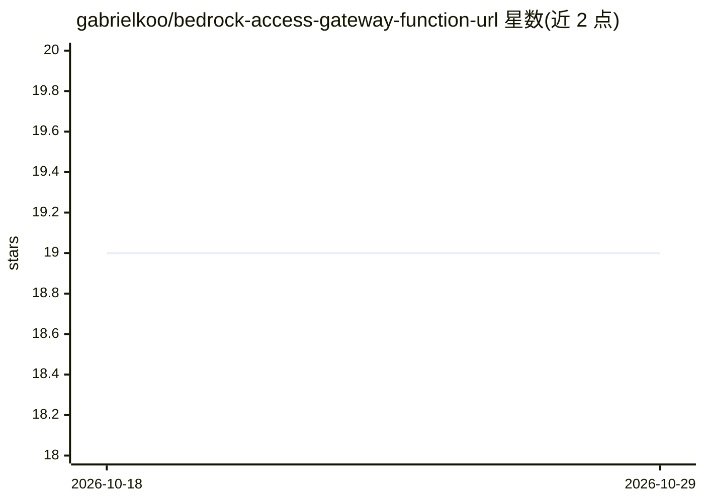

# gabrielkoo/bedrock-access-gateway-function-url

⭐ 19 · Shell · MIT · 推送 2026-06-22 · [GitHub](https://github.com/gabrielkoo/bedrock-access-gateway-function-url) · [官网](https://dev.to/aws-builders/use-amazon-bedrock-models-via-an-openai-api-compatible-serverless-endpoint-now-without-fixed-cost-5hf5) · 个人维护

**给开发者的 Amazon Bedrock OpenAI 兼容 API 网关（Lambda 无固定成本）**

基于原 bedrock-access-gateway 项目修改，结合 aws-lambda-web-adapter，在 AWS Lambda + Function URL 上部署 OpenAI API 兼容端点，支持流式输出。移除原方案的应用负载均衡器与 Fargate 等固定成本组件（原方案 >US$16/月），改为按需付费的 Lambda 执行费用；将 Docker Lambda 运行时替换为 Python 运行时以降低冷启动。提供本地（Docker + AWS SAM CLI）与 CloudShell 两种部署方式，以及可选的 Secrets Manager 模板。面向需要在 Bedrock 上使用 OpenAI 兼容接口且控制基础设施成本的开发者。

## 筛选速览

| 维度 | 判定 | 备注 |
|---|---|---|
| AI 角色 | `ai-ecosystem` | LLM/agent 周边工具 |
| 许可风险 | `permissive` | MIT |
| 部署形态 | `self-host` | docker 或自建部署 |
| 模型依赖 | locked-api |  |
| 硬件要求 | — | 无带数字的原话,不猜 |
| 安装摩擦 | `low` | 无编译、无系统依赖或容器化 |
| 成熟度 | — | 结构信号不足 |

## 能力要点

- 在 Lambda + Function URL 上提供 OpenAI API 兼容端点，支持流式输出
- 移除 ALB/Fargate 等固定成本组件，按需付费模式
- 可用 --no-embeddings 排除 numpy/tiktoken 依赖以缩减 Lambda Layer
- 支持本地与 CloudShell 部署，可选 Secrets Manager 模板管理 API key

## 适用场景

- 用 OpenAI SDK/客户端直接调用 Bedrock 模型
- 以无固定成本方式在 AWS 上自建 OpenAI 兼容代理
- 为 Bedrock 端点做 API key 的 Secrets Manager 管理与轮换

## 场景标签

`模型网关` · 领域:Agent 开发

## 证据(README 行号)

> L37: This repo is combining the great works of the original implementations of bedrock-access-gateway with aws-lambda-we
> L39: This solution is more cost effective than the original `bedrock-access-gateway` solution as it removes the need of 

## 星数曲线

2026-10-18 19 → 2026-10-29 19（+0）

---
*卡片 v1 · prompt 1.4 · 生成 2026-10-28 · 置信度 mid · 依据 README sha `9643d9b5563f` · [字段定义](../../DATASET.md)*
