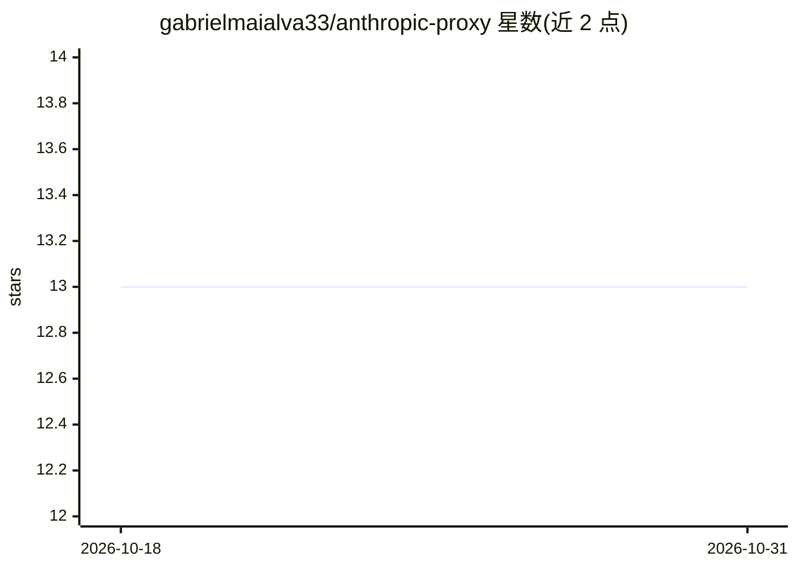

# gabrielmaialva33/anthropic-proxy

⭐ 13 · Python · MIT · 推送 2026-03-23 · [GitHub](https://github.com/gabrielmaialva33/anthropic-proxy) · 个人维护

**让 Claude Code 使用任意 OpenAI 兼容模型的代理服务器**

基于 FastAPI 的协议转换代理：将 Anthropic API 格式的请求实时转译为 OpenAI 格式，使 Claude Code CLI 可接入 GPT-4o、DeepSeek、OpenRouter、Azure、Ollama 等任意 OpenAI 兼容后端。机制包括 SSE 流式工具调用、o1/o3/o4 reasoning 块转 Claude thinking 块、非 Claude 提供商的输入清洗、tiktoken 精确计数、Claude 模型直通 Anthropic。通过克隆源码安装或 Docker Compose 部署，配置 .env 指定后端与模型映射。

## 筛选速览

| 维度 | 判定 | 备注 |
|---|---|---|
| AI 角色 | `ai-ecosystem` | LLM/agent 周边工具 |
| 许可风险 | `permissive` | MIT |
| 部署形态 | `self-host` | docker 或自建部署 |
| 模型依赖 | local-ok | 支持本地模型 |
| 硬件要求 | — | 无带数字的原话,不猜 |
| 安装摩擦 | `low` | 无编译、无系统依赖或容器化 |
| 成熟度 | — | 结构信号不足 |

## 能力要点

- Anthropic↔OpenAI 格式实时转译，支持多提供商（OpenAI/OpenRouter/DeepSeek/Azure/Ollama/NVIDIA NIM）
- o1/o3/o4 reasoning_content 转 Claude thinking 块
- SSE 流式增量工具调用参数与客户端断连取消
- Claude 模型请求直通 Anthropic API，Docker Compose 单命令部署

## 适用场景

- 让 Claude Code 使用 GPT-4o/DeepSeek/OpenRouter 等非 Anthropic 模型
- 通过 Ollama 本地模型驱动 Claude Code
- 在 Azure OpenAI 部署上运行 Claude Code

## 场景标签

`模型网关` · 领域:Agent 开发

## 证据(README 行号)

> L24: **Claude on OpenAI** is a proxy server that lets you use Claude Code (Anthropic's CLI tool) with any OpenAI-compati
> L25: API. It translates between Anthropic's API format and OpenAI's format on the fly — supporting GPT-4o, DeepSeek,
> L30: - **Multi-provider support** — OpenAI, OpenRouter, DeepSeek, Azure, Ollama, NVIDIA NIM, and more

## 星数曲线

2026-10-18 13 → 2026-10-31 13（+0）

---
*卡片 v1 · prompt 1.4 · 生成 2026-10-31 · 置信度 mid · 依据 README sha `95d6433ba729` · [字段定义](../../DATASET.md)*
