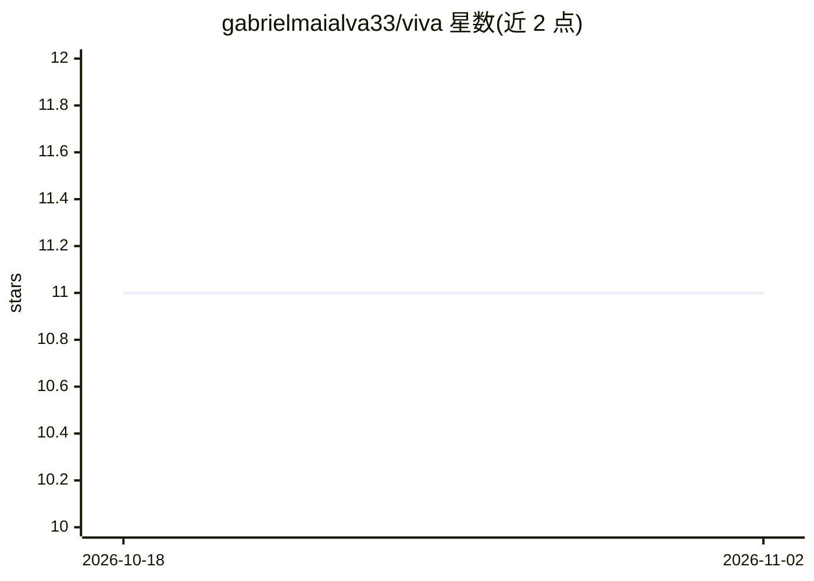

# gabrielmaialva33/viva

⭐ 11 · Gleam · NOASSERTION · 推送 2026-07-07 · [GitHub](https://github.com/gabrielmaialva33/viva) · [官网](https://gabrielmaialva33.github.io/viva/) · 个人维护

**用 Gleam/BEAM 构建的情感数字生命模拟系统**

以 Gleam 语言运行于 BEAM/OTP 27+ 的数字生命实验项目：通过 PAD 情绪动力学与 Ornstein-Uhlenbeck 过程模拟情绪，HRR 全息编码实现记忆，模块涵盖神经网络（viva_tensor 张量）、表观遗传漂移检测，以及死亡-业力-重生/解脱的生命周期（bardo）。采用 OTP 监督树组织进程，README 称支持 10 万+ 实体、3.14M soul-ticks/sec。测试为最小冒烟套件，完整套件重建中；具身化与自主性阶段标记为未开始。

## 筛选速览

| 维度 | 判定 | 备注 |
|---|---|---|
| AI 角色 | `ai-native` | 本体是模型或模型工具 |
| 许可风险 | `none` | NOASSERTION |
| 部署形态 | `None` |  |
| 模型依赖 | — | README 未给出锁定关系 |
| 硬件要求 | — | 无带数字的原话,不猜 |
| 安装摩擦 | `low` | 无编译、无系统依赖或容器化 |
| 成熟度 | `idea` | |

## 能力要点

- PAD 情绪动力学 + Ornstein-Uhlenbeck 过程实时模拟
- HRR 全息编码记忆与 GLYPH 符号编码
- OTP 监督树组织进程，支持 10 万+ 并发实体
- 死亡→业力→重生/解脱的生命周期模块

## 适用场景

- 研究人工生命与涌现意识的进程级模拟
- 实验情绪动力学与全息记忆编码
- 在 BEAM 虚拟机上运行大规模实体并发仿真

## 场景标签

 · 领域:人工生命/情感计算

## 证据(README 行号)

> L62: |`viva/soul/*`|PAD emotional dynamics + Ornstein-Uhlenbeck|
> L66: |`viva/neural/*`|Layers, networks (tensors via `viva_tensor`)|
> L87: |**Emergence**|Consciousness = many processes talking|

## 星数曲线

2026-10-18 11 → 2026-11-02 11（+0）

---
*卡片 v1 · prompt 1.4 · 生成 2026-11-02 · 置信度 mid · 依据 README sha `fcbf9ca6abcd` · [字段定义](../../DATASET.md)*
