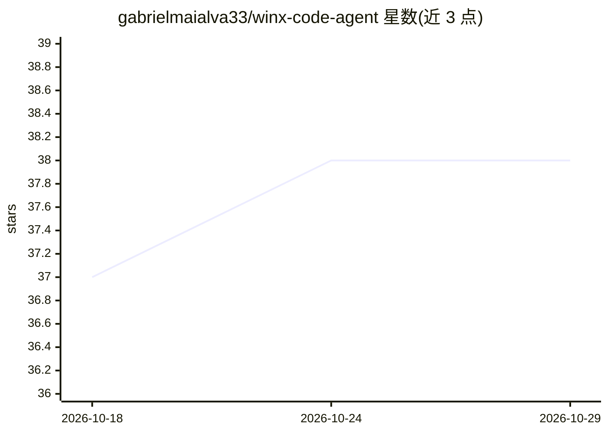

# gabrielmaialva33/winx-code-agent

⭐ 38 · Rust · MIT · 推送 2026-10-28 · [GitHub](https://github.com/gabrielmaialva33/winx-code-agent) · [官网](https://crates.io/crates/winx-code-agent) · 个人维护 · 中文 README

**Rust 编写的 MCP 运行时：给 AI 编码代理提供持久 shell 与文件编辑**

Winx 是一个用 Rust 实现的 remote-first MCP runtime，为 AI 编码代理提供真实 PTY shell 会话、统一的 EditFiles 文件编辑工具（含验证与撤销）、tree-sitter 代码导航（13 种语言）、图像读取与上下文交接。部署主路径为 Streamable HTTP 端点（默认仅绑定回环、强 bearer token、多 principal 隔离），同时保留 stdio 供 Claude Code、Cursor、VS Code 等本地客户端使用。每会话由 winx-guardian 进程守护，HTTP 断连后可通过 thread_id 恢复。通过 cargo install 安装，MIT 许可。

## 筛选速览

| 维度 | 判定 | 备注 |
|---|---|---|
| AI 角色 | `ai-ecosystem` | LLM/agent 周边工具 |
| 许可风险 | `permissive` | MIT |
| 部署形态 | `desktop` | 安装包/桌面程序 |
| 模型依赖 | — | README 未给出锁定关系 |
| 硬件要求 | — | 无带数字的原话,不猜 |
| 安装摩擦 | `medium` | 含编译或系统依赖之一 |
| 成熟度 | — | 结构信号不足 |

## 能力要点

- 持久 PTY 会话：winxd 控制面 + 每会话一个 winx-guardian，断连可恢复
- 单一 EditFiles 变更工具：创建/编辑/批量/补丁/验证/撤销，计划失败不写入
- 四种工具目录 profile（terminal/read-only/coding/full）按 principal 收权
- 默认密钥脱敏与可选 Landlock 沙箱（Linux）

## 适用场景

- 让 ChatGPT 等云端 MCP 客户端远程操作本机 shell 与代码仓库
- Claude Code/Cursor 等本地客户端通过 stdio 获得持久终端与受控文件编辑
- 多用户场景下按 principal 隔离会话与权限

## 场景标签

 · 领域:开发者工具/Agent 基础设施

## 证据(README 行号)

> L25: Winx is a **remote-first MCP runtime** for agents that need a real shell, guarded file-editing primitives, reposito
> L27: **Streamable HTTP** endpoint for ChatGPT and other cloud or networked MCP clients; stdio remains fully supported fo
> L30: On Linux, macOS, and native Windows, Winx separates the MCP adapter from the processes that own each PTY. `winxd`

## 星数曲线

2026-10-18 37 → 2026-10-29 38（+1）

---
*卡片 v1 · prompt 1.4 · 生成 2026-10-25 · 置信度 high · 依据 README sha `678b7e04fbb7` · [字段定义](../../DATASET.md)*
