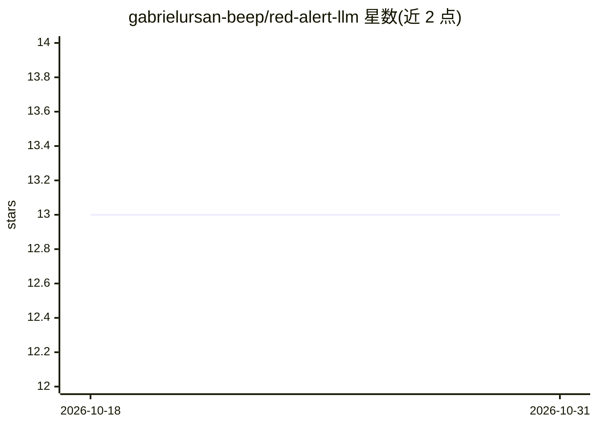

# gabrielursan-beep/red-alert-llm

⭐ 13 · Shell · MIT · 推送 2026-03-24 · [GitHub](https://github.com/gabrielursan-beep/red-alert-llm) · 个人维护

**U盘离线 AI 工具箱：本地 LLM 对话+离线维基+加密保管库**

可整体拷贝到 USB SSD 便携运行的工具箱：通过 llamafile/KoboldCpp 在本机运行 Qwen3 系列模型（4B/8B/14B，按 RAM 自动选择）提供本地 AI 聊天，用 Kiwix 加载离线 Wikipedia/医学百科等 ZIM 知识库，并含 200 GB VeraCrypt AES-256 加密保管库。零安装、可完全离线，覆盖 Windows/macOS/Linux/Android/iOS；移动端需 PocketPal AI 加载 GGUF 模型。面向个人用户，含英/罗双语文档及电商联盟链接。

## 筛选速览

| 维度 | 判定 | 备注 |
|---|---|---|
| AI 角色 | `ai-native` | 本体是模型或模型工具 |
| 许可风险 | `permissive` | MIT |
| 部署形态 | `None` |  |
| 模型依赖 | — | README 未给出锁定关系 |
| 硬件要求 | `cpu-ok` | |
| 安装摩擦 | `medium` | 含编译或系统依赖之一 |
| 成熟度 | — | 结构信号不足 |

## 能力要点

- U盘直启、零安装、完全离线运行
- Qwen3 多档模型按 RAM/GPU 自动选择，119 种语言对话
- Kiwix 离线知识库：英文维基 680 万条、医学百科 7.3 万条等
- 200 GB VeraCrypt AES-256 加密保管库

## 适用场景

- 无网络/断网环境随时使用本地 AI 与维基百科
- 应急包中随身携带加密的个人证件、病历与密码库
- 手机通过 USB-OTG 从 SSD 读取模型与知识库

## 场景标签

`聊天机器人` `文档问答` · 领域:对话与助手

## 证据(README 行号)

> L20: - **AI Chat Assistant** — talk to an AI in 119 languages (including Romanian) powered by Qwen3, running locally on 
> L29: - [x] **AI Chat** in 119 languages (Qwen3, running 100% locally)

## 星数曲线

2026-10-18 13 → 2026-10-31 13（+0）

---
*卡片 v1 · prompt 1.4 · 生成 2026-10-31 · 置信度 high · 依据 README sha `9ccc1ec44b5a` · [字段定义](../../DATASET.md)*
