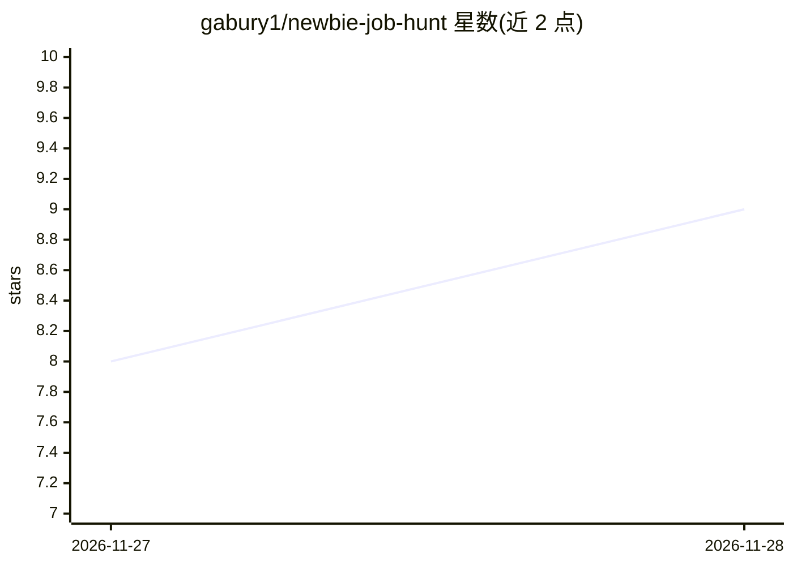

# gabury1/newbie-job-hunt

⭐ 9 · Python · 推送 2026-11-26 · [GitHub](https://github.com/gabury1/newbie-job-hunt) · 个人维护

**韩国开发新人/初级岗位每日整理的 AI 可读招聘公告数据集**

每日早晨收集韩国面向开发新人/初级的在招岗位，按统一格式整理成 markdown 笔记供 AI 读取：公告 597 条、公司 432 家，含日程、流程、职责、资格、材料，公司附营收（电子公示）、人数变动（国民年金）、Blind 评分与评论摘要等。分类与筛选由 Claude 判定。提供 AGENTS.md 供 AI 直接读取、Claude Code 技能安装、postings.jsonl 逐行索引。每日更新，依赖原链接核对。

## 筛选速览

| 维度 | 判定 | 备注 |
|---|---|---|
| AI 角色 | `ai-knowledge` | 知识聚合/清单类 |
| 许可风险 | `none` | — |
| 部署形态 | `library` | 以包/库形式分发 |
| 模型依赖 | — | README 未给出锁定关系 |
| 硬件要求 | — | 无带数字的原话,不猜 |
| 安装摩擦 | `low` | 无编译、无系统依赖或容器化 |
| 成熟度 | — | 结构信号不足 |

## 能力要点

- 597 条在招岗位统一格式整理，含 jsonl 索引
- 432 家公司背景摘要（营收、人数、Blind 评分）
- 每日早晨更新，支持 Claude Code 技能安装
- 公告分类由 Claude 判定并标注不确定性

## 适用场景

- 让 AI 按我的条件筛选适合的岗位
- 读取公告与公司笔记准备求职材料与自荐方向
- 跟踪每日新增的初级开发岗位

## 场景标签

`科研工具` · 领域:学习与行业

## 证据(README 行号)

> L11: 지금 접수 중인 국내 개발 신입 · 주니어 공고를 매일 아침 모아, **AI 에 그대로 먹이기 좋게** 정리한 마크다운입니다.
> L66: |`AGENTS.md`|AI 에게 주는 안내: 파일 구조 · 고르는 순서 · 지킬 것|
> L68: |`postings.jsonl`|공고 한 줄에 하나. 회사 · 제목 · 카테고리 · 직무 · 요구 경력 · 마감 · 올라온 날 · 원문 링크 · 노트 경로 · 큰 회사인지(`big_company`) · 오늘

## 星数曲线

2026-11-27 8 → 2026-11-28 9（+1）

---
*卡片 v1 · prompt 1.4 · 生成 2026-11-27 · 置信度 high · 依据 README sha `e973b9504535` · [字段定义](../../DATASET.md)*
