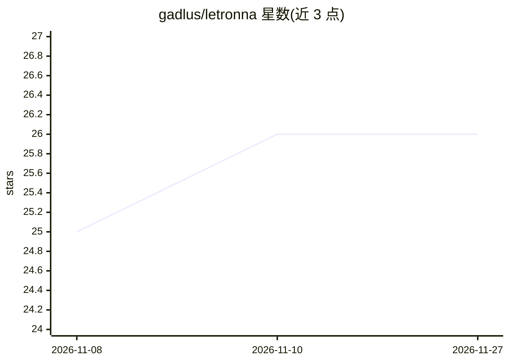

# gadlus/letronna

⭐ 26 · Rust · MIT · 推送 2026-11-26 · [GitHub](https://github.com/gadlus/letronna) · [官网](https://letronna.ai) · 组织维护

**自带云与加密钱包的 Rust 编程 Agent 桌面/终端应用**

用 Rust 编写的 Agent 应用，提供桌面（GPUI）、终端与手机（即将推出）三种形态，共用同一 Rust 核心。用户以提示词下达任务，Agent 可在本地或 Letronna Cloud 构建并托管 Web 应用至可访问的 live link；通过 x402 协议用加密钱包支付 API 费用。本地支持文件、shell、浏览器等工具、子 Agent 协作、本地 GGUF 模型运行，可接入 OpenAI/Anthropic/Gemini/Ollama/OpenRouter 等多种模型来源，支持 MCP 与插件扩展。README 自述处于 Alpha 阶段，会有粗糙之处与破坏性变更。

## 筛选速览

| 维度 | 判定 | 备注 |
|---|---|---|
| AI 角色 | `ai-native` | 本体是模型或模型工具 |
| 许可风险 | `permissive` | MIT |
| 部署形态 | `desktop` | 安装包/桌面程序 |
| 模型依赖 | — | README 未给出锁定关系 |
| 硬件要求 | — | 无带数字的原话,不猜 |
| 安装摩擦 | `medium` | 含编译或系统依赖之一 |
| 成熟度 | `idea` | |

## 能力要点

- Letronna Cloud 云端构建并托管 Web 应用，输出 live link
- 经 x402 协议用加密钱包支付 API 费用
- 本地运行 GGUF 模型（GPU、无需联网）
- 支持 MCP 服务器、JavaScript/Python 插件与多种模型来源

## 适用场景

- 用自然语言让 Agent 构建 Web 应用并获取在线链接
- 在终端后台运行长任务并在本地使用 Agent 工具
- 按需接入自有模型或云服务商，并查看每条回答的 token 成本

## 场景标签

`编码 Agent` · 领域:编码与开发

## 证据(README 行号)

> L5:  An agent with its own cloud and wallet. Prompt in, live link out.
> L18: Letronna is an agent with its own cloud and wallet. It builds on your computer or in Letronna Cloud, hosts the resu
> L44: - Hosted models on your Letronna account (frontier models at 70% off, see pricing), your ChatGPT or Claude plan, Op

## 星数曲线

2026-11-08 25 → 2026-11-27 26（+1）

---
*卡片 v1 · prompt 1.4 · 生成 2026-11-18 · 置信度 high · 依据 README sha `4511789812c0` · [字段定义](../../DATASET.md)*
