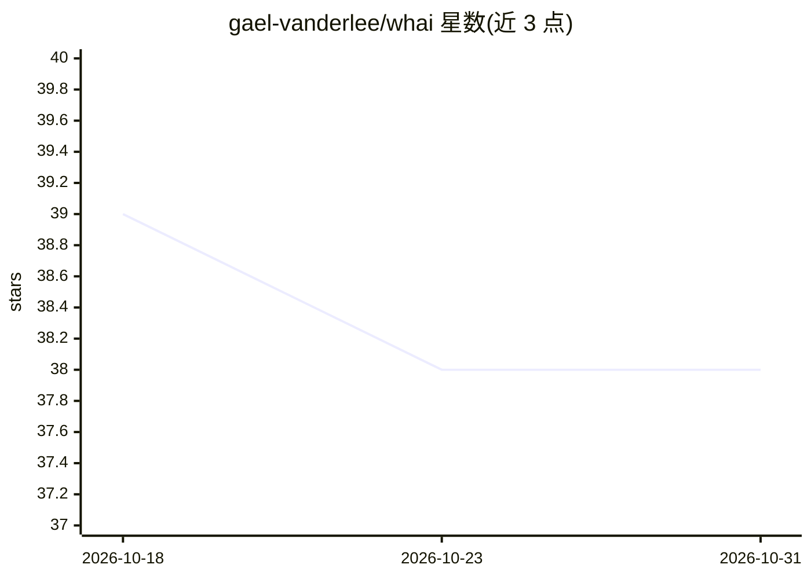

# gael-vanderlee/whai

⭐ 38 · Python · MIT · 推送 2026-04-30 · [GitHub](https://github.com/gael-vanderlee/whai) · 个人维护

**开发者的终端 AI 助手：在 shell 中按需调用 LLM 诊断错误、生成命令**

Whai 是集成于原生 shell 的轻量终端 AI 助手，面向在终端工作中遇到报错或需要命令的开发者。它在 tmux 或 whai shell 会话中读取命令历史与输出作为上下文，向配置的 LLM 提问并生成命令建议，每条命令需显式 approve/reject 才执行。支持基于文件的 Roles 持久化上下文、MCP 工具扩展、tmux 多窗格定位，通过 LiteLLM 支持 OpenAI、Anthropic、Gemini、Ollama 等多种提供方。以 Python 包（pip/uv/pipx）安装，需 Python 3.10+。

## 筛选速览

| 维度 | 判定 | 备注 |
|---|---|---|
| AI 角色 | `ai-native` | 本体是模型或模型工具 |
| 许可风险 | `permissive` | MIT |
| 部署形态 | `library` | 以包/库形式分发 |
| 模型依赖 | local-ok | 支持本地模型 |
| 硬件要求 | — | 无带数字的原话,不猜 |
| 安装摩擦 | `low` | 无编译、无系统依赖或容器化 |
| 成熟度 | — | 结构信号不足 |

## 能力要点

- 从 tmux/记录会话读取命令历史与输出作为上下文诊断错误
- 所有命令需显式 approve/reject 确认后执行
- 文件式 Roles 持久化用户环境与偏好上下文
- 通过 LiteLLM 支持多种提供方含本地 Ollama/LM Studio/vLLM

## 适用场景

- 命令失败时直接在终端让 AI 诊断错误原因
- 用自然语言生成 shell 命令并确认后执行
- SSH 到远程机器时无需切换浏览器获取帮助

## 场景标签

`AI 助手` · 领域:对话与助手

## 证据(README 行号)

> L9: Whai is a simple way to call an LLM from terminal. It is not an agent that wipes your hard drive while you are in th
> L19: `whai` is a lightweight AI terminal assistant that integrates directly into your native shell and workflow.

## 星数曲线

2026-10-18 39 → 2026-10-31 38（-1）

---
*卡片 v1 · prompt 1.4 · 生成 2026-10-25 · 置信度 high · 依据 README sha `092bd1f00501` · [字段定义](../../DATASET.md)*
