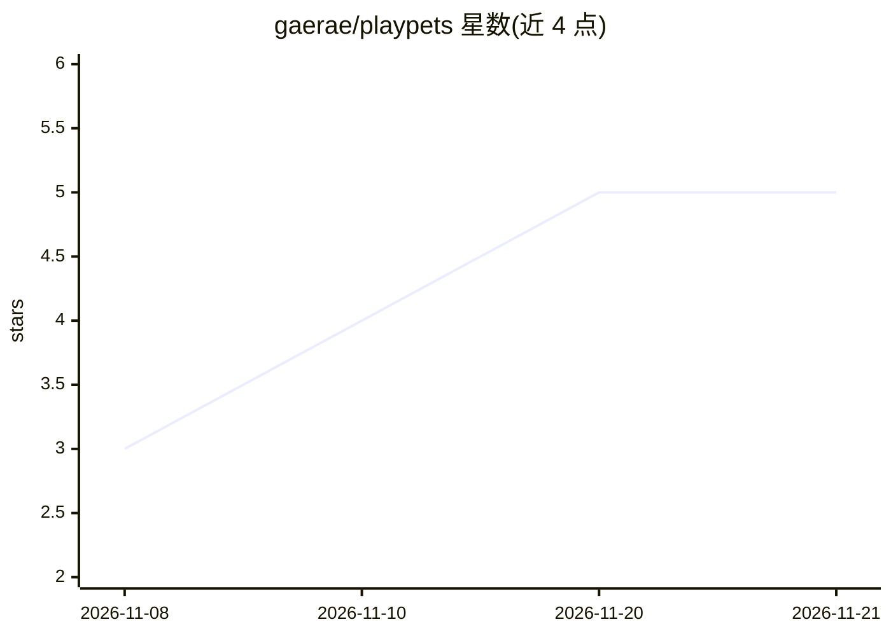

# gaerae/playpets

⭐ 5 · JavaScript · MIT · 推送 2026-11-20 · [GitHub](https://github.com/gaerae/playpets) · [官网](https://playpets.gaerae.com/) · 个人维护 · 中文 README

**桌面宠物应用：四只内置宠物经你选择的 AI 互相聊天并响应编码工具**

运行于 macOS/Windows/Linux 的开源（MIT）桌面宠物程序：内置 Daisy、Clover、Pip、Miso 四只宠物，可读取为 ChatGPT/Codex 制作的自定义宠物文件，最多 12 只同时在桌面活动；宠物与用户及彼此的对话通过用户接入的 AI 完成，每只宠物绑定一个 AI 连接。同时通过 hooks 与 MCP 集成 Claude Code、Codex CLI、Gemini CLI、Cursor 等编码工具，宠物对编码过程做出反应。提供 garden、钓鱼、203 项图鉴等玩法，支持四语言界面，数据本地存储，通过 brew/winget/Store/deb/AppImage 安装。

## 筛选速览

| 维度 | 判定 | 备注 |
|---|---|---|
| AI 角色 | `ai-enhanced` | 去掉 AI 部分产品仍成立 |
| 许可风险 | `permissive` | MIT |
| 部署形态 | `desktop` | 安装包/桌面程序 |
| 模型依赖 | local-ok | 支持本地模型 |
| 硬件要求 | — | 无带数字的原话,不猜 |
| 安装摩擦 | `low` | 无编译、无系统依赖或容器化 |
| 成熟度 | — | 结构信号不足 |

## 能力要点

- 读取 Codex 宠物文件格式，无需 Codex 即可运行，最多 12 只同屏
- 宠物对话接入用户选择的 AI：Claude Code/Codex CLI 登录、本地 Ollama、OpenAI/Grok API key 或 OpenAI 兼容服务器
- 通过 hooks 与 MCP 服务器对 Claude Code、Gemini CLI、Cursor 等编码工具的步骤做出反应
- 庭院玩法：种植、钓鱼、4 个小游戏、203 项图鉴，支持季节变化

## 适用场景

- 写代码时让桌面宠物陪伴并对构建/测试过程做出反应
- 接入本地 Ollama 让宠物聊天数据不离开本机
- 导入社区制作的 Codex 宠物文件扩展角色

## 场景标签

`AI 助手` · 领域:对话与助手

## 证据(README 行号)

> L5: **Pet friends that live on your desktop: four come with the app, any Codex pet can join them, and up to 12 talk to e
> L43: |AI connections|Signed-in Claude Code or Codex CLI, local Ollama, an OpenAI or Grok (xAI) API key, or an OpenAI-com

## 星数曲线

2026-11-08 3 → 2026-11-21 5（+2）

---
*卡片 v1 · prompt 1.4 · 生成 2026-11-21 · 置信度 mid · 依据 README sha `6dc3c5162a59` · [字段定义](../../DATASET.md)*
