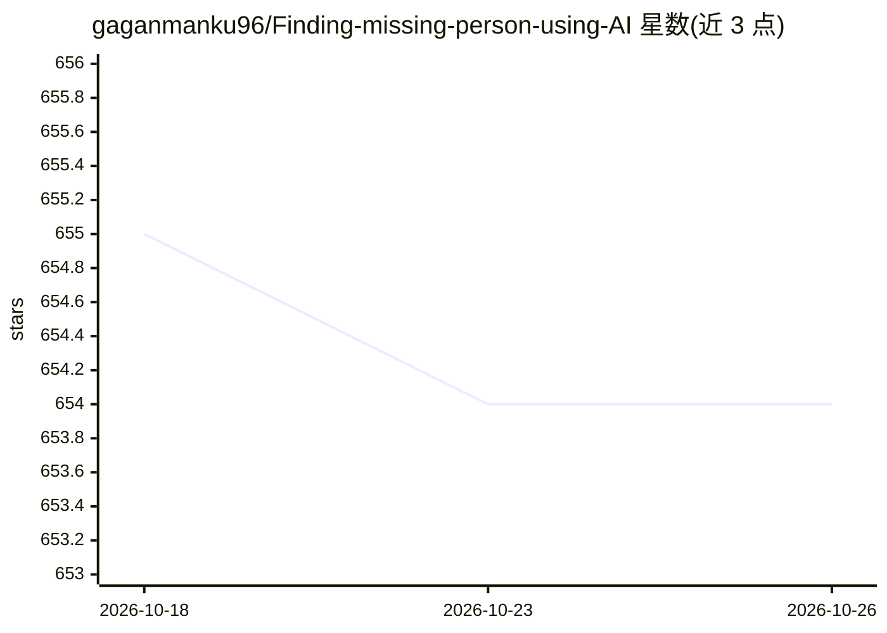

# gaganmanku96/Finding-missing-person-using-AI

⭐ 654 · Python · 推送 2026-03-13 · [GitHub](https://github.com/gaganmanku96/Finding-missing-person-using-AI) · 个人维护

**面向失踪人口报案与目击比对人脸识别 Web 系统**

面向失踪人口查找场景的 Streamlit Web 应用：警官注册案件上传照片，系统用 MediaPipe 提取 468 点人脸网格并生成 1404 维向量；公众通过免登录门户提交照片或视频目击，管理员触发匹配时用 scikit-learn KNN 跨两组数据比对人脸，命中后自动标记为 Found 并向报案人发邮件。数据存 SQLite，含基于角色的访问控制、印度城市分布地图与演示数据脚本，模型下载后可完全离线运行。属本科毕业设计项目。

## 筛选速览

| 维度 | 判定 | 备注 |
|---|---|---|
| AI 角色 | `ai-native` | 本体是模型或模型工具 |
| 许可风险 | `none` | — |
| 部署形态 | `library` | 以包/库形式分发 |
| 模型依赖 | — | README 未给出锁定关系 |
| 硬件要求 | — | 无带数字的原话,不猜 |
| 安装摩擦 | `low` | 无编译、无系统依赖或容器化 |
| 成熟度 | — | 结构信号不足 |

## 能力要点

- MediaPipe 468 点人脸网格提取与 KNN 向量匹配（含置信度）
- 视频目击上传，逐帧自动提取人脸
- 公众免登录提交门户与警官/管理员角色权限分离
- 模型缓存后双门户可完全离线运行

## 适用场景

- 警方登记失踪案件并与公众目击照片自动比对
- 跟踪案件状态与各城市案件分布地图
- 比对命中后自动邮件通知报案人

## 场景标签

`人脸识别` · 领域:感知与多模态

## 证据(README 行号)

> L29: A family in Haridwar reports their child missing. An officer opens the portal, uploads a photo, and the AI immediat
> L55: 1. **Officer registers a case** → uploads a photo → AI extracts a 468-point face mesh
> L66: |AI matching|KNN on 1,404-dimensional face vectors; shows confidence %|

## 星数曲线

2026-10-18 655 → 2026-10-26 654（-1）

---
*卡片 v1 · prompt 1.4 · 生成 2026-10-21 · 置信度 high · 依据 README sha `56acf7a975a4` · [字段定义](../../DATASET.md)*
