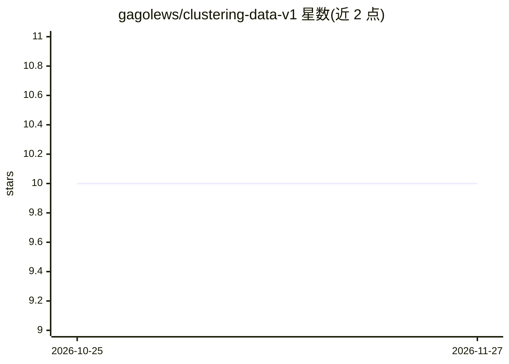

# gagolews/clustering-data-v1

⭐ 10 · Jupyter Notebook · NOASSERTION · 推送 2026-10-22 · [GitHub](https://github.com/gagolews/clustering-data-v1) · [官网](https://clustering-benchmarks.gagolewski.com/) · 个人维护

**聚类算法基准测试的数据集套件（版本1）**

该仓库托管聚类基准测试框架第一版的数据集：聚合、规范化机器学习与数据挖掘文献中已有的聚类基准数据集，并引入不同维度、规模与簇类型的新数据集。README 提供文件格式说明、Python/R/MATLAB 示例代码、数据集浏览器入口及引用规范，数据仅限研究用途并要求引用相应文献。版本历史记录各次发布的数据集增删与重命名，快照存档于 Zenodo。

## 筛选速览

| 维度 | 判定 | 备注 |
|---|---|---|
| AI 角色 | `ai-knowledge` | 知识聚合/清单类 |
| 许可风险 | `none` | NOASSERTION |
| 部署形态 | `None` |  |
| 模型依赖 | — | README 未给出锁定关系 |
| 硬件要求 | — | 无带数字的原话,不猜 |
| 安装摩擦 | `low` | 无编译、无系统依赖或容器化 |
| 成熟度 | — | 结构信号不足 |

## 能力要点

- 聚合并标准化文献中已有的聚类基准数据集，并新增多维度/多规模数据集
- 附带 Python/R/MATLAB 示例代码与数据集浏览器
- 各版本快照通过 Zenodo DOI 存档
- 配有关联论文（SoftwareX 2022, DOI: 10.1016/j.softx.2022.101270）

## 适用场景

- 为聚类算法的评测实验获取标准化基准数据
- 复现文献中的聚类基准测试结果
- 引用规范化数据集开展聚类方法研究

## 场景标签

 · 领域:机器学习/基准数据集

## 证据(README 行号)

> L4: The aim of this project is to **aggregate, polish, and standardise the
> L11: It hosts the datasets from version 1 of the benchmark suite.

## 星数曲线

2026-10-25 10 → 2026-11-27 10（+0）

---
*卡片 v1 · prompt 1.4 · 生成 2026-11-19 · 置信度 high · 依据 README sha `e2bc316a0017` · [字段定义](../../DATASET.md)*
