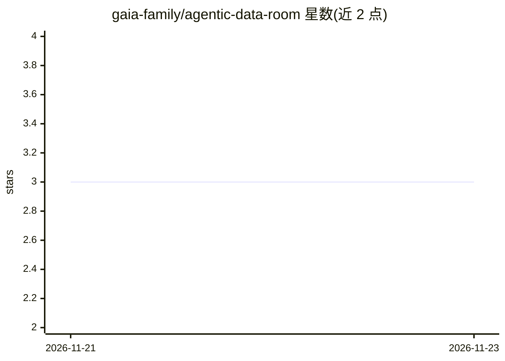

# gaia-family/agentic-data-room

⭐ 3 · JavaScript · MIT · 推送 2026-11-20 · [GitHub](https://github.com/gaia-family/agentic-data-room) · 组织维护

**给融资创始人的文档数据室问答机器人，每个数字带引用**

将投资人数据室（文件夹）之上叠加一层聊天：投资人用自然语言提问，机器人只从创始人选定的文档作答，每个数字附文件引用，合同条款原文引用而非转述，需要重跑财务模型或文档缺失的问题输出固定拒绝句，所有提问进入创始人可读日志。架构上不使用检索，将策展后的全语料以 prompt cache 系统块放入上下文；财务表格 CSV 与合同 PDF 由正则表加小型模型回退的两个路由附加。需 Python 3.10+、Node 20+ 与 Anthropic API key，git clone 后 make demo 运行。

## 筛选速览

| 维度 | 判定 | 备注 |
|---|---|---|
| AI 角色 | `ai-native` | 本体是模型或模型工具 |
| 许可风险 | `permissive` | MIT |
| 部署形态 | `None` |  |
| 模型依赖 | locked-api |  |
| 硬件要求 | — | 无带数字的原话,不猜 |
| 安装摩擦 | `low` | 无编译、无系统依赖或容器化 |
| 成熟度 | — | 结构信号不足 |

## 能力要点

- 无检索架构：全语料作为 prompt-cached 系统块进入每次请求
- 每个数字强制引用 [doc:slug]，slug 映射文件打开原始 PDF/表格
- 三类固定拒绝句处理 what-if 与文档外问题
- 15-23 题的 eval 集作为规格，make eval 双模式校验

## 适用场景

- 融资期间让投资人自助提问而不用翻文件夹
- 控制投资人拿到的文档版本并留下提问日志
- 为尽职调查问答提供带引用的可核查回答

## 场景标签

`文档问答` · 领域:知识与检索

## 证据(README 行号)

> L5: This repository puts a chat on top of the folder. Investors ask questions in plain English and the bot answers from 
> L17: **No retrieval, everything in context.** A curated data room is 30 to 40 thousand tokens and the model's context wi
> L70: Next.js 15. Claude Sonnet answers through a forced tool call: TLDR, typed blocks, sources. Claude Haiku routes when

## 星数曲线

2026-11-21 3 → 2026-11-23 3（+0）

---
*卡片 v1 · prompt 1.4 · 生成 2026-11-22 · 置信度 high · 依据 README sha `2ef48503f80a` · [字段定义](../../DATASET.md)*
