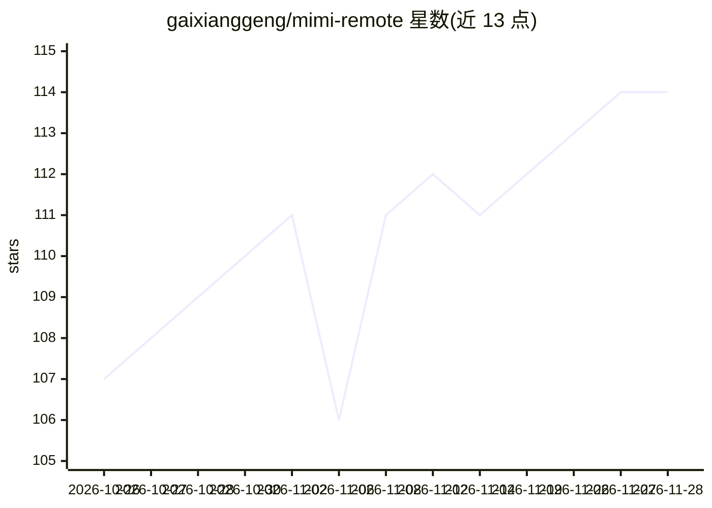

# gaixianggeng/mimi-remote

⭐ 114 · Swift · NOASSERTION · 推送 2026-11-27 · [GitHub](https://github.com/gaixianggeng/mimi-remote) · [官网](https://remote.code89757.com/) · 个人维护 · 中文 README

**在 iPhone/iPad 上远程监控与审批电脑上的 Codex/Claude Code 会话**

由 iOS/iPadOS 客户端与运行在 Mac/Windows/Linux 上的 agentd 网关组成的远程控制工具：电脑上的 Codex、Claude Code（实验性）与 DeepSeek Harness（可选）会话经受信任局域网或 Tailscale 连接到手机，展示实时回复、工具步骤与任务状态，支持批准/拒绝命令、排队指令、锁屏通知；Codex 场景下可查看变更与 Git 操作。会话数据留在本机，无云账号；可选 Mimi Relay 为订阅制的端到端加密中继。

## 筛选速览

| 维度 | 判定 | 备注 |
|---|---|---|
| AI 角色 | `ai-ecosystem` | LLM/agent 周边工具 |
| 许可风险 | `none` | NOASSERTION |
| 部署形态 | `desktop` | 安装包/桌面程序 |
| 模型依赖 | — | README 未给出锁定关系 |
| 硬件要求 | — | 无带数字的原话,不猜 |
| 安装摩擦 | `low` | 无编译、无系统依赖或容器化 |
| 成熟度 | — | 结构信号不足 |

## 能力要点

- 一个应用同时控制 Codex、Claude Code 与可选的 DeepSeek Harness
- 工具审批按钮化：Reject / Allow Once / Allow for Session / Always Allow
- 支持配对多台电脑并切换，会话留在所属电脑上
- agent 运行全程留在本机，无 Mimi 账号与云端会话托管

## 适用场景

- 离开电脑时继续跟进 agent 编程任务并批准命令
- 在 iPad 多栏界面同时管理多台电脑上的会话
- 通过 Tailscale 在外网连接家中电脑上的 agent

## 场景标签

`编码 Agent` · 领域:编码与开发

## 证据(README 行号)

> L5:  Remote control for Codex and Claude Code.
> L7:  Your Mac, Windows, or Linux computer keeps running the agent. From your iPhone or iPad, you watch the progress, rep
> L73: `agentd` on your computer authenticates the app and routes it to the selected runtime. There is no Mimi account or 

## 星数曲线

2026-10-26 107 → 2026-11-28 114（+7）

---
*卡片 v1 · prompt 1.4 · 生成 2026-11-28 · 置信度 high · 依据 README sha `4f4a7c6ab48b` · [字段定义](../../DATASET.md)*
