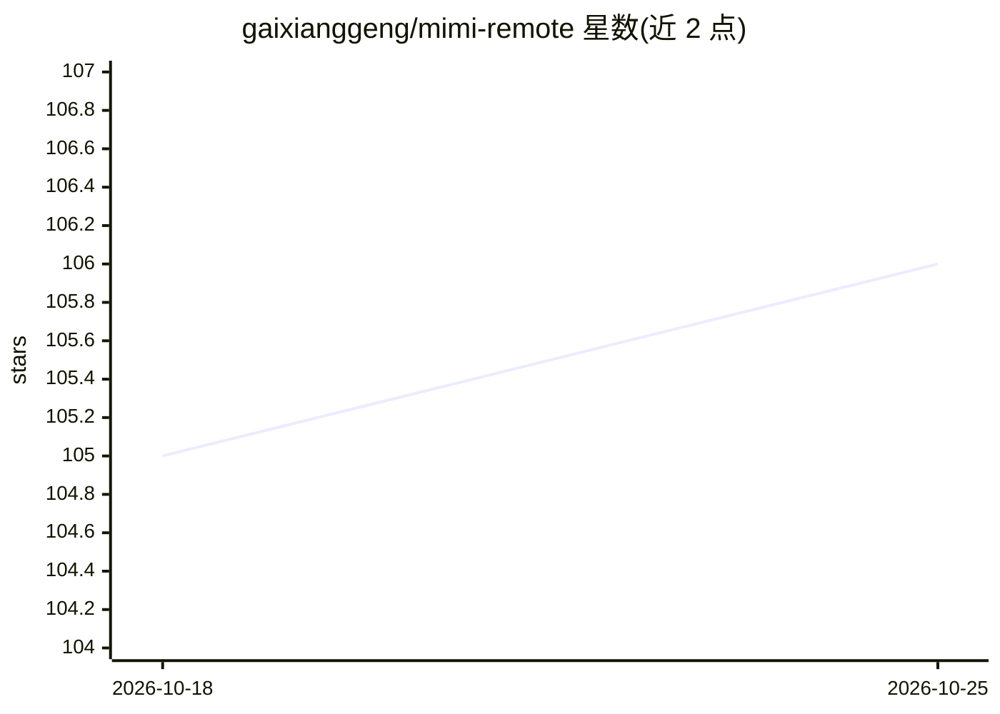

# gaixianggeng/mimi-remote

⭐ 107 · Swift · NOASSERTION · 推送 2026-10-25 · [GitHub](https://github.com/gaixianggeng/mimi-remote) · [官网](https://remote.code89757.com/) · 个人维护 · 中文 README

**从 iPhone/iPad 远程操控 Codex 与 Claude Code 的自托管客户端**

由 iPhone/iPad 应用与计算机上的 agentd 网关组成：agent 运行在用户自己的 Mac/Windows/Linux 计算机上，手机端通过受信局域网或 Tailscale 连接，以原生界面查看会话进度、回复提问、批准或拒绝工具调用，并支持多台计算机配对切换。支持 Codex（主运行时）、Claude Code（实验性适配器）与可选的 DeepSeek Harness。无云账户、无会话托管，仅通知走小型推送服务。GPLv3 开源，移动端经 App Store/TestFlight 或源码构建获取。

## 筛选速览

| 维度 | 判定 | 备注 |
|---|---|---|
| AI 角色 | `ai-ecosystem` | LLM/agent 周边工具 |
| 许可风险 | `none` | NOASSERTION |
| 部署形态 | `desktop` | 安装包/桌面程序 |
| 模型依赖 | locked-api |  |
| 硬件要求 | — | 无带数字的原话,不猜 |
| 安装摩擦 | `low` | 无编译、无系统依赖或容器化 |
| 成熟度 | `idea` | |

## 能力要点

- iPhone/iPad 原生界面查看会话、回复与批准工具调用
- 一台手机配对多台计算机并切换，凭据留在各计算机上
- 同时支持 Codex、Claude Code 与 DeepSeek Harness 三种运行时
- 自托管、无云账户，经局域网/Tailscale/Tailcat 直连

## 适用场景

- 离开电脑时用手机跟进 Codex 或 Claude Code 的执行进度并批准操作
- 在外出场景通过锁屏通知响应 agent 的审批请求
- 在 iPad 上以多栏工作区管理多个项目的会话

## 场景标签

`编码 Agent` · 领域:编码与开发

## 证据(README 行号)

> L5:  Remote control for Codex and Claude Code.
> L7:  Your Mac, Windows, or Linux computer keeps running the agent. From your iPhone or iPad, you watch the progress, rep
> L13: Codex, Claude Code, your projects, and your sessions all stay on your own computer. Mimi Remote connects to it over

## 星数曲线

2026-10-18 105 → 2026-10-25 106（+1）

---
*卡片 v1 · prompt 1.4 · 生成 2026-10-23 · 置信度 high · 依据 README sha `2e0e759f5429` · [字段定义](../../DATASET.md)*
