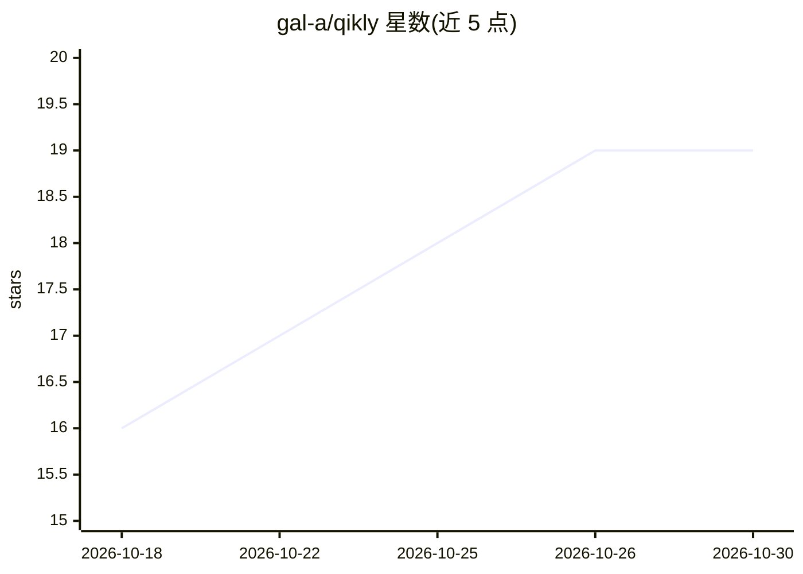

# gal-a/qikly

⭐ 19 · Python · Apache-2.0 · 推送 2026-10-25 · [GitHub](https://github.com/gal-a/qikly) · [官网](https://test.qikly.com/) · 个人维护

**分离编写代码与测试的 AI 测试工具：验收标准对编码代理保密**

面向开发者的 Python 测试工具，针对自包含数据处理模块（ETL、合并、计算、校验）。工作分三步：--score 在代码副本中逐个注入故障，找出未被现有测试覆盖的行为（不调用模型、免费）；--scaffold 起草验收标准 YAML（spec 代理只读 README 与 docstring，不读代码）；--tasks 由测试代理依据标准写测试，另一个看不到验收标准的编码代理修复代码副本直至通过，--take-tests 将测试拷回项目。支持 Gemini/Anthropic/OpenAI API key，可作 MCP 服务器运行（已在 VS Code 与 Claude Code 测试），也可 --install-skill 安装技能文件。限制：不适合大型既有仓库。

## 筛选速览

| 维度 | 判定 | 备注 |
|---|---|---|
| AI 角色 | `ai-ecosystem` | LLM/agent 周边工具 |
| 许可风险 | `permissive` | Apache-2.0 |
| 部署形态 | `library` | 以包/库形式分发 |
| 模型依赖 | — | README 未给出锁定关系 |
| 硬件要求 | — | 无带数字的原话,不猜 |
| 安装摩擦 | `low` | 无编译、无系统依赖或容器化 |
| 成熟度 | — | 结构信号不足 |

## 能力要点

- 测试代理与编码代理分离：编码代理永不接触验收标准
- --score 注入故障评估现有测试覆盖，不调用模型、免费
- spec 代理只读 README 与 docstrings 起草验收标准，不读代码
- 提供 MCP 服务器模式与 Claude Code/Codex/Cursor 等 Skill 安装

## 适用场景

- 验证 AI 编码代理写的代码，不信任同一代理自写的测试
- 为自包含 Python 模块（ETL/计算/校验）生成独立测试套件
- 在需要独立验证的领域（汽车、医疗设备、金融）做代码收敛

## 场景标签

`代码审查` · 领域:编码与开发

## 证据(README 行号)

> L105: 3. **`--tasks` runs it**, which needs an API key (Google Gemini, Anthropic or
> L190: qikly runs as an MCP server, so an agent in

## 星数曲线

2026-10-18 16 → 2026-10-30 19（+3）

---
*卡片 v1 · prompt 1.4 · 生成 2026-10-28 · 置信度 high · 依据 README sha `1a7e71f5e920` · [字段定义](../../DATASET.md)*
