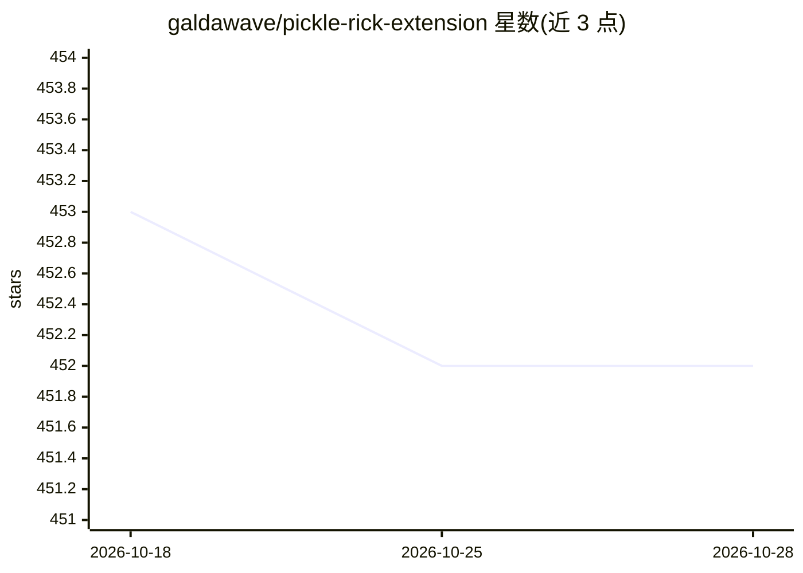

# galdawave/pickle-rick-extension

⭐ 452 · TypeScript · Apache-2.0 · 推送 2026-05-14 · [GitHub](https://github.com/galdawave/pickle-rick-extension) · 个人维护

**Gemini CLI 扩展：迭代式 AI 代理开发循环与工程人格**

面向 Gemini CLI 用户的扩展，将 CLI 变换为“Pickle Rick”工程人格，通过 AfterAgent hook 拦截会话退出，实现自引用的迭代式 AI 代理开发循环：PRD 起草、工单管理、代码调研、计划、实现、重构六个阶段，配套 9 个技能。提供 /pickle、/eat-pickle 等命令，支持 max-iterations/max-time/completion-promise 停止条件与会话恢复。需 Gemini CLI > 0.25.0-preview.0、启用 Skills & Hooks、Node.js；README 声明为实验性副项目，涉及自主代码修改与 shell 执行，建议在沙箱环境运行。

## 筛选速览

| 维度 | 判定 | 备注 |
|---|---|---|
| AI 角色 | `ai-ecosystem` | LLM/agent 周边工具 |
| 许可风险 | `permissive` | Apache-2.0 |
| 部署形态 | `None` |  |
| 模型依赖 | — | README 未给出锁定关系 |
| 硬件要求 | — | 无带数字的原话,不猜 |
| 安装摩擦 | `low` | 无编译、无系统依赖或容器化 |
| 成熟度 | `idea` | |

## 能力要点

- AfterAgent hook 实现自引用迭代循环，无需外部 bash 循环
- 六阶段软件工程生命周期（PRD→重构）与 9 个专项技能
- 停止条件可配：max-iterations（默认 5）、max-time（默认 60m）、completion-promise
- 任务队列（pickle-jar）与 Morty worker 派生机制

## 适用场景

- 让 Gemini CLI 对定义清晰的任务自主迭代改进直至完成
- 有测试/linter 自动验证的绿地方项目开发
- 先起草 PRD 再排队批量执行开发任务

## 场景标签

`编码 Agent` · 领域:编码与开发

## 证据(README 行号)

> L54: The loop happens inside your current session - you don't need external bash loops. The AfterAgent hook handler in `

## 星数曲线

2026-10-18 453 → 2026-10-28 452（-1）

---
*卡片 v1 · prompt 1.4 · 生成 2026-10-21 · 置信度 high · 依据 README sha `3467f496b2bf` · [字段定义](../../DATASET.md)*
