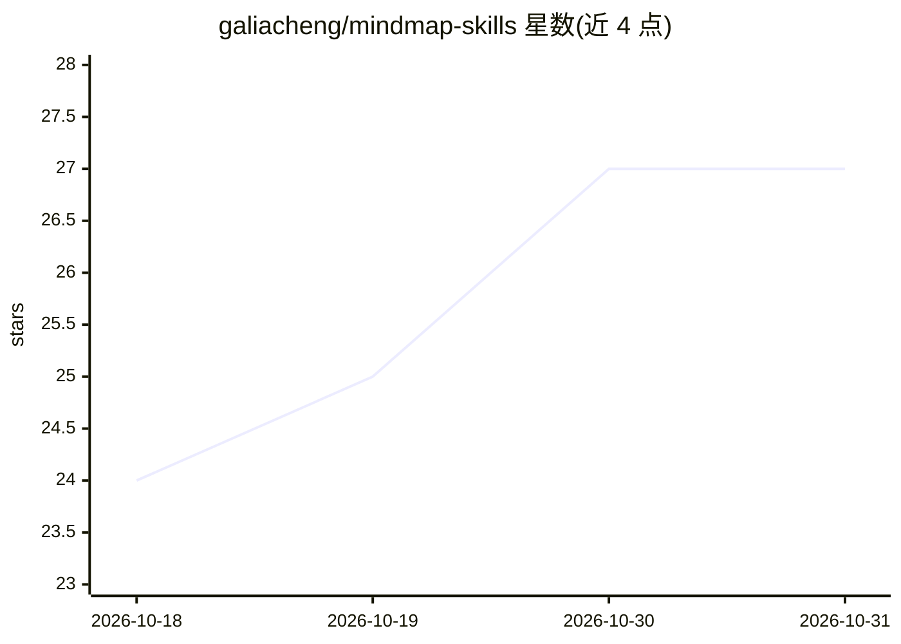

# galiacheng/mindmap-skills

⭐ 27 · Shell · MIT · 推送 2026-10-12 · [GitHub](https://github.com/galiacheng/mindmap-skills) · [官网](https://galiacheng.github.io/mindmap-skills/examples/) · 个人维护 · 中文 README

**把文件/URL/文本/主题转为 Markmap 交互思维导图的 agent 技能**

面向支持 Agent Skills 的编码 agent 的技能包：读取文件、URL、粘贴文本或主题，生成 Markmap 格式的 .md 思维导图，可选 --render 生成可独立打开的交互式 HTML。提供 /mindmap（默认英文）与 /mindmap-zh（默认简体中文）两个技能，均支持多语言输入与 19 种输出语言。通过 npx skills 命令安装，项目级为默认，可 --global。限制：HTML 渲染需要 Bash 与 Node.js，judge panel 需独立子 agent 且 token 消耗较大。

## 筛选速览

| 维度 | 判定 | 备注 |
|---|---|---|
| AI 角色 | `ai-ecosystem` | LLM/agent 周边工具 |
| 许可风险 | `permissive` | MIT |
| 部署形态 | `library` | 以包/库形式分发 |
| 模型依赖 | — | README 未给出锁定关系 |
| 硬件要求 | — | 无带数字的原话,不猜 |
| 安装摩擦 | `low` | 无编译、无系统依赖或容器化 |
| 成熟度 | — | 结构信号不足 |

## 能力要点

- 支持文件、URL、粘贴文本、主题四类输入
- 生成 Markmap .md 与可选交互式 HTML
- 19 种输出语言，--lang auto 跟随源语言
- 多 agent 评审面板（--panel）可选增强结构化

## 适用场景

- 让编码 agent 把长文或报告整理成思维导图
- 从网页文章一键生成可缩放折叠的交互式导图
- 用中文生成主题概览导图用于学习梳理

## 场景标签

`知识库管理` · 领域:知识与检索

## 证据(README 行号)

> L10: For coding agents that support **Agent Skills** and the required capabilities. Produces Markmap `.md` files and opt
> L3: **An agent skill that turns files, URLs, notes, and topics into interactive mindmaps.**

## 星数曲线

2026-10-18 24 → 2026-10-31 27（+3）

---
*卡片 v1 · prompt 1.4 · 生成 2026-10-27 · 置信度 high · 依据 README sha `5cdb1466e339` · [字段定义](../../DATASET.md)*
