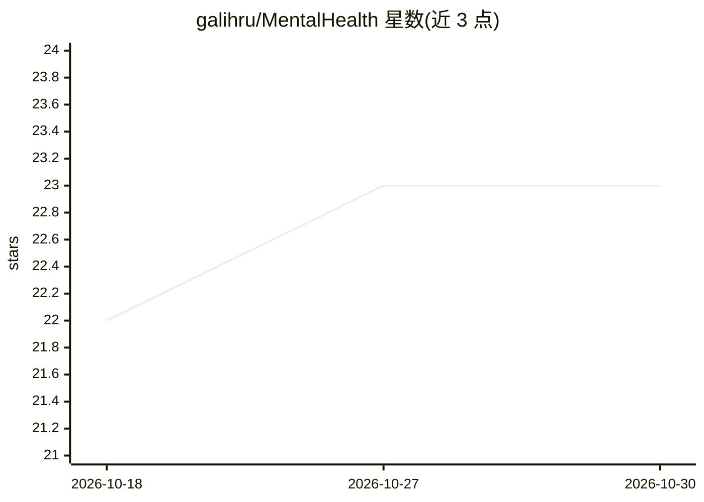

# galihru/MentalHealth

⭐ 23 · HTML · MIT · 推送 2026-10-29 · [GitHub](https://github.com/galihru/MentalHealth) · [官网](https://galihru.github.io/MentalHealth/) · 个人维护

**基于面部表情的情绪检测应用与 npm 包**

通过摄像头或图像分析用户面部特征以识别情绪，基于面部关键点几何量（唇距、脸颊抬升、眉毛下压、下颌张合等）计算快乐、悲伤、愤怒、惊讶等情绪，并提供按情绪状态的建议与联系心理健康专业人员的通知功能。技术栈还列出语音分析与 IoT 健康传感器（GSR/MAX30102/BH1750/ESP32）。以 npm 包分发，支持 CommonJS 与 ESM 导入，提供 detectEmotion(imagePath) 与 detectEmotionLive() 两个函数，可配置 basic/advanced 模型与置信度阈值。

## 筛选速览

| 维度 | 判定 | 备注 |
|---|---|---|
| AI 角色 | `ai-native` | 本体是模型或模型工具 |
| 许可风险 | `permissive` | MIT |
| 部署形态 | `library` | 以包/库形式分发 |
| 模型依赖 | — | README 未给出锁定关系 |
| 硬件要求 | — | 无带数字的原话,不猜 |
| 安装摩擦 | `low` | 无编译、无系统依赖或容器化 |
| 成熟度 | — | 结构信号不足 |

## 能力要点

- 基于面部关键点几何量的情绪计算（快乐/悲伤/愤怒/惊讶/中性）
- 支持图像文件与摄像头实时两种检测方式
- 可配置 basic/advanced 模型与最小置信度阈值
- djb2Hash 哈希生成基于面部特征的 FaceID

## 适用场景

- 从照片或摄像头实时识别我的面部情绪
- 根据当前情绪状态获得个性化建议
- 情绪异常时收到联系心理健康专业人员的提醒

## 场景标签

`人脸识别` · 领域:感知与多模态

## 证据(README 行号)

> L4: - **Emotion Detection**: Analyzes user's facial expressions to identify emotions.
> L118: EmotionDetection.detectEmotion('path/to/image.jpg')

## 星数曲线

2026-10-18 22 → 2026-10-30 23（+1）

---
*卡片 v1 · prompt 1.4 · 生成 2026-10-27 · 置信度 mid · 依据 README sha `4a20f105a923` · [字段定义](../../DATASET.md)*
