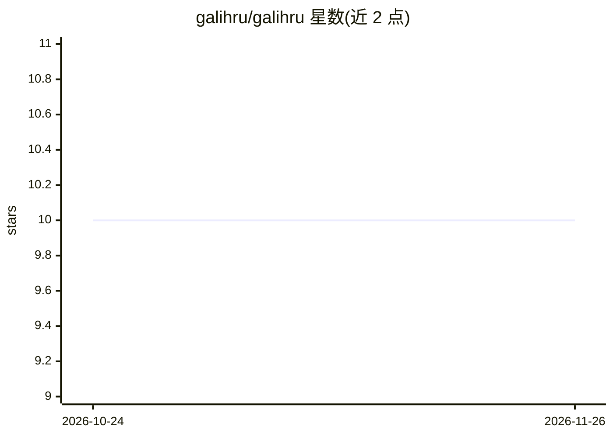

# galihru/galihru

⭐ 10 · JavaScript · Apache-2.0 · 推送 2026-11-14 · [GitHub](https://github.com/galihru/galihru) · [官网](https://galihru.github.io/galihru/) · 个人维护

**印尼物理研究者 Galih Ridho Utomo 的个人简介页**

该仓库是一个 GitHub 个人主页（profile README），内容为 Galih Ridho Utomo 的个人档案：联系方式、中英双语个人简介、编程语言清单，以及其 80 余个 GitHub 仓库的星标列表。另含教育背景、BRIN 工作经历、发表论文、获奖记录、组织经历与研究历史等条目。仓库不含可安装或可运行的软件，仅为个人信息的静态展示。

## 筛选速览

| 维度 | 判定 | 备注 |
|---|---|---|
| AI 角色 | `ai-knowledge` | 知识聚合/清单类 |
| 许可风险 | `permissive` | Apache-2.0 |
| 部署形态 | `None` |  |
| 模型依赖 | — | README 未给出锁定关系 |
| 硬件要求 | — | 无带数字的原话,不猜 |
| 安装摩擦 | `low` | 无编译、无系统依赖或容器化 |
| 成熟度 | — | 结构信号不足 |

## 能力要点

- 中英双语个人简介与联系方式
- 列出掌握的 15 种编程语言
- 汇总本人 80 余个 GitHub 仓库及星标数
- 含教育、工作、论文、获奖与研究历史条目

## 适用场景

- 了解该作者的研究方向与项目列表
- 获取作者的联系方式与合作信息

## 场景标签

 · 领域:个人主页/简历

## 证据(README 行号)

> L1: # Galih Ridho Utomo
> L11: I am a Physics (S1) at State University of Semarang. Now I am continuing my master's degree in Beijing. I am known 
> L527: ## Education Background

## 星数曲线

2026-10-24 10 → 2026-11-26 10（+0）

---
*卡片 v1 · prompt 1.4 · 生成 2026-11-19 · 置信度 high · 依据 README sha `972e6a4b5e4f` · [字段定义](../../DATASET.md)*
