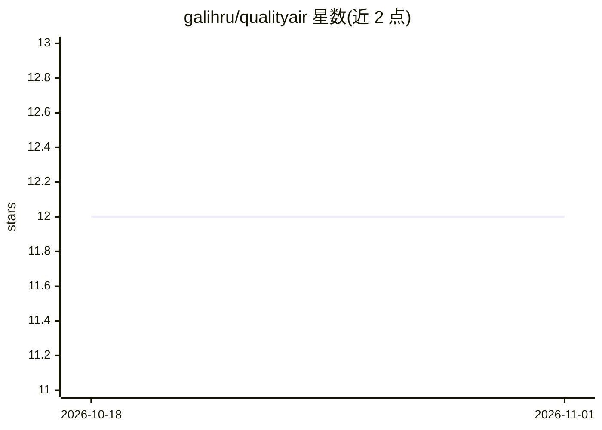

# galihru/qualityair

⭐ 12 · C++ · Apache-2.0 · 推送 2026-10-31 · [GitHub](https://github.com/galihru/qualityair) · [官网](https://galihru.github.io/qualityair/) · 个人维护

**ESP32+MQ-7 一氧化碳实时监测系统，数据推送 GitHub**

基于 ESP32 开发板与 MQ-7 传感器的 CO（一氧化碳）实时监测项目：读取传感器模拟值换算为 PPM 浓度，通过 NTP 同步时间戳，每 5 秒将 JSON 数据经 Base64 编码后以 HTTP PUT 请求推送到 GitHub 仓库存储，并用 SHA 校验防止数据覆盖，支持 Android 小组件查看。面向 Arduino/物联网爱好者，需自行准备硬件、Arduino IDE 环境与 GitHub personal access token；README 提及传感器需校准并预热 24 小时。

## 筛选速览

| 维度 | 判定 | 备注 |
|---|---|---|
| AI 角色 | `ai-enhanced` | 去掉 AI 部分产品仍成立 |
| 许可风险 | `permissive` | Apache-2.0 |
| 部署形态 | `None` |  |
| 模型依赖 | — | README 未给出锁定关系 |
| 硬件要求 | — | 无带数字的原话,不猜 |
| 安装摩擦 | `low` | 无编译、无系统依赖或容器化 |
| 成熟度 | — | 结构信号不足 |

## 能力要点

- MQ-7 传感器读取 CO 浓度并换算为 PPM
- 每 5 秒通过 GitHub API 推送 JSON 数据，含 SHA 一致性校验
- NTP 时间同步与 Base64 编码传输
- Android 设备小组件展示数据

## 适用场景

- 搭建低成本室内 CO 浓度实时监测
- 利用 GitHub 仓库作为免费数据存储与时间序列记录
- 在手机上通过小组件查看实时 CO 读数

## 场景标签

 · 领域:物联网/环境监测

## 证据(README 行号)

> L3: This project involves using an **ESP32** microcontroller and **MQ-7 CO sensor** to monitor CO (Carbon Monoxide) leve
> L6: - Real-time CO monitoring using the MQ-7 sensor.

## 星数曲线

2026-10-18 12 → 2026-11-01 12（+0）

---
*卡片 v1 · prompt 1.4 · 生成 2026-11-01 · 置信度 mid · 依据 README sha `b6b2033b7aff` · [字段定义](../../DATASET.md)*
