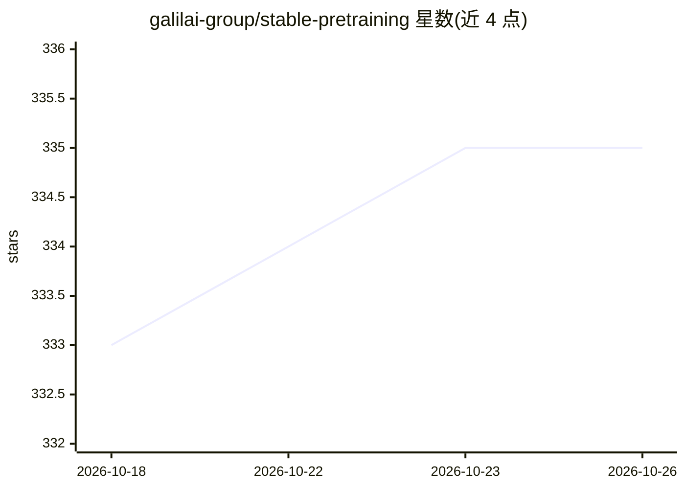

# galilai-group/stable-pretraining

⭐ 335 · Python · MIT · 推送 2026-09-29 · [GitHub](https://github.com/galilai-group/stable-pretraining) · [官网](https://galilai-group.github.io/stable-pretraining/) · 组织维护

**PyTorch Lightning 上的自监督学习训练框架：换目标不换训练流程**

面向研究者的自监督学习（SSL）预训练库：用户只定义返回字典的 forward 函数，即可复用统一的 Module/DataModule/OnlineProbe/Manager 流程，获得训练、验证、checkpoint、断点续训与本地实验注册表。内置 SimCLR、DINO、MAE、BYOL、VICReg、LeJEPA 等方法目录，提供 GPU 侧批量增强（kornia）、在线探针与多种表征诊断回调。实验性 JAX/Flax 后端为可选安装且与 torch 路径隔离，部分方法与 ViT 特性尚未迁移。以 pip 包与源码两种方式安装。

## 筛选速览

| 维度 | 判定 | 备注 |
|---|---|---|
| AI 角色 | `ai-ecosystem` | LLM/agent 周边工具 |
| 许可风险 | `permissive` | MIT |
| 部署形态 | `library` | 以包/库形式分发 |
| 模型依赖 | — | README 未给出锁定关系 |
| 硬件要求 | — | 无带数字的原话,不猜 |
| 安装摩擦 | `medium` | 含编译或系统依赖之一 |
| 成熟度 | `idea` | |

## 能力要点

- 只定义 forward 即可更换 SSL 目标，训练/评估/checkpoint 流程复用
- 方法目录含 SimCLR、DINO、MAE、BYOL、VICReg、LeJEPA 等
- GPU 侧批量增强（kornia）替代 CPU worker 内逐样本增强
- 在线评估回调：线性探针、KNN、RankMe、LiDAR、CLIP 零样本等

## 适用场景

- 在统一训练框架下对比不同自监督学习方法
- 预训练时在线跟踪表征质量与下游准确率
- 自定义 SSL 目标函数并保留 checkpoint、续训与日志流程

## 场景标签

`模型训练` · 领域:训练与推理

## 证据(README 行号)

> L15: `stable-pretraining` helps researchers compare and customize self-supervised
> L16: learning methods on PyTorch Lightning. Define a forward function returning a
> L26: The method catalog includes SimCLR, DINO, MAE, BYOL, VICReg, LeJEPA, and more.

## 星数曲线

2026-10-18 333 → 2026-10-26 335（+2）

---
*卡片 v1 · prompt 1.4 · 生成 2026-10-21 · 置信度 high · 依据 README sha `a2835596047a` · [字段定义](../../DATASET.md)*
