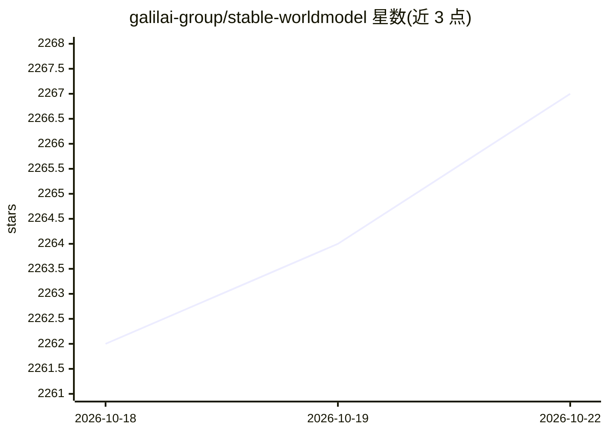

# galilai-group/stable-worldmodel

⭐ 2,267 · Python · MIT · 推送 2026-10-02 · [GitHub](https://github.com/galilai-group/stable-worldmodel) · [官网](https://galilai-group.github.io/stable-worldmodel/) · 组织维护

**统一接口的世界模型研究评测平台：采集、训练、MPC 评估**

面向世界模型（world model）研究的可复现实验平台：用同一接口覆盖数据采集、模型训练与基于模型预测控制的评估三个阶段，内置跨 DeepMind Control Suite、Gymnasium、OGBench、Craftax、Atari 等 40 余个环境（多数带可控视觉/物理变化因子），并提供 CEM/MPPI 等规划求解器与 DINO-WM、LeWM 等 JEPA 基线实现。支持 Lance/HDF5/video/LeRobot 多种数据格式与格式转换，附带 swm 命令行。README 声明处于活跃开发期，API 可能在小版本间变动。

## 筛选速览

| 维度 | 判定 | 备注 |
|---|---|---|
| AI 角色 | `ai-ecosystem` | LLM/agent 周边工具 |
| 许可风险 | `permissive` | MIT |
| 部署形态 | `library` | 以包/库形式分发 |
| 模型依赖 | — | README 未给出锁定关系 |
| 硬件要求 | — | 无带数字的原话,不猜 |
| 安装摩擦 | `low` | 无编译、无系统依赖或容器化 |
| 成熟度 | `idea` | |

## 能力要点

- 采集-训练-评估三阶段统一接口
- 40+ 标准化环境，多数带独立可控变化因子用于零样本泛化评测
- 7 种规划求解器与 DINO-WM/LeWM 等 JEPA 基线实现
- Lance/HDF5/folder/video/LeRobot 数据格式注册表与吞吐/存储基准

## 适用场景

- 在同一套环境与求解器上对比自己的世界模型与基线
- 零样本分布偏移泛化评测
- 采集、转换与检查世界模型训练数据集

## 场景标签

`模型评测` `模型训练` · 领域:评测与运维

## 证据(README 行号)

> L3:  A platform for reproducible world model research and evaluation.
> L21: `stable-worldmodel` provides a single, unified interface for the three stages of world model research — **collectin

## 星数曲线

2026-10-18 2,262 → 2026-10-22 2,267（+5）

---
*卡片 v1 · prompt 1.4 · 生成 2026-10-21 · 置信度 high · 依据 README sha `c9867b6ab725` · [字段定义](../../DATASET.md)*
