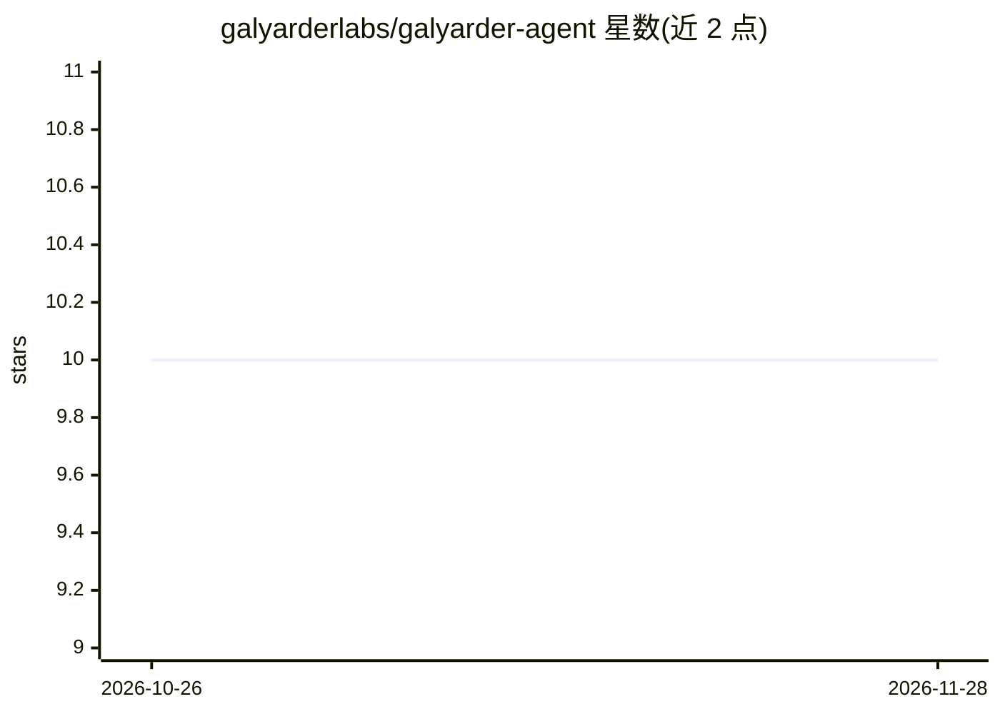

# galyarderlabs/galyarder-agent

⭐ 10 · Python · MIT · 推送 2026-10-11 · [GitHub](https://github.com/galyarderlabs/galyarder-agent) · [官网](https://galyarderlabs.github.io/galyarder-agent/) · 个人维护

**自托管 agent 运行时：持久记忆+多渠道接入**

本地优先的开源 agent 运行时，通过 g-agent CLI 提供 onboard/status/gateway 等命令。agent 具备跨会话持久记忆（SQLite 与 MEMORY.md/PROFILE.md 等文件）、自定义工具、定时任务与 systemd 守护进程，可经 WhatsApp、Telegram、Discord、Email、CLI 渠道通信，并通过 gws CLI 接入 Google Workspace。安全模型含 allowFrom、工作区沙箱、审批模式与数据目录隔离。源于 nanobot 与 hermes-agent，MIT 许可。

## 筛选速览

| 维度 | 判定 | 备注 |
|---|---|---|
| AI 角色 | `ai-ecosystem` | LLM/agent 周边工具 |
| 许可风险 | `permissive` | MIT |
| 部署形态 | `library` | 以包/库形式分发 |
| 模型依赖 | — | README 未给出锁定关系 |
| 硬件要求 | — | 无带数字的原话,不猜 |
| 安装摩擦 | `low` | 无编译、无系统依赖或容器化 |
| 成熟度 | `idea` | |

## 能力要点

- 多渠道存在：WhatsApp/Telegram/Discord/Email/CLI
- 持久记忆文件（MEMORY.md 等）与 SQLite 状态存储
- 多模型路由：直连 provider、本地推理或 OpenAI 兼容代理
- 显式安全边界：allowlist、工作区沙箱、审批模式与操作日志

## 适用场景

- 搭建个人常驻助手管理邮箱、日历与定时任务
- 让 agent 以部门形式并行处理财务、客服等工作流
- 在本地自托管环境中编排多个通信渠道的 agent

## 场景标签

`Agent 框架` · 领域:Agent 开发

## 证据(README 行号)

> L18: `g-agent` is an open-source, local-first agent runtime.
> L20: It lets you run agents that carry persistent memory, domain expertise, custom tools, and execution models. These ag
> L60: - Multi-model routing through direct providers, local inference, or OpenAI-compatible proxies.

## 星数曲线

2026-10-26 10 → 2026-11-28 10（+0）

---
*卡片 v1 · prompt 1.4 · 生成 2026-11-19 · 置信度 high · 依据 README sha `4f4fa6c841c8` · [字段定义](../../DATASET.md)*
