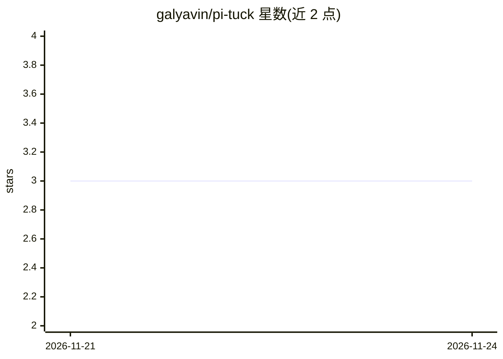

# galyavin/pi-tuck

⭐ 3 · TypeScript · MIT · 推送 2026-11-21 · [GitHub](https://github.com/galyavin/pi-tuck) · [官网](https://www.npmjs.com/package/pi-tuck) · 个人维护

**Pi 编码代理的确定性上下文压缩扩展：不调模型即可裁剪并回溯历史**

pi-tuck 是 Pi 编码代理的扩展包，接管自动压缩与 /compact：从会话本身构建压缩摘要，不调用模型，同一会话产出相同摘要，成本为零 token，中位耗时 0.08 秒（1.0.1 版 128k 实测）。提供 tuck_recall 工具按关键词检索并逐字读回被裁剪的历史消息与工具结果。在 Pi 1.2.0+ 于 macOS/Linux/Windows 运行，README 中披露基准涵盖范围限制及裁剪 4 次后不做记忆保持声明。

## 筛选速览

| 维度 | 判定 | 备注 |
|---|---|---|
| AI 角色 | `ai-ecosystem` | LLM/agent 周边工具 |
| 许可风险 | `permissive` | MIT |
| 部署形态 | `library` | 以包/库形式分发 |
| 模型依赖 | — | README 未给出锁定关系 |
| 硬件要求 | — | 无带数字的原话,不猜 |
| 安装摩擦 | `low` | 无编译、无系统依赖或容器化 |
| 成熟度 | — | 结构信号不足 |

## 能力要点

- 从会话记录生成压缩摘要，不调用模型，零 token 成本
- tuck_recall 按关键词检索并逐字读回被裁剪的历史消息与工具结果
- 摘要内容规则明确：保留当前提示、最近轮次、最多 60 个文件指针、kept reads/searches 等
- 提供 installCompaction SDK 接口供嵌入 Pi 的宿主程序使用

## 适用场景

- 长会话中压缩上下文而不消耗模型调用
- 让代理事后查找早前被裁剪出摘要的修复细节
- 小窗口模型下管理上下文与请求拒绝

## 场景标签

`编码 Agent` `Agent 记忆` · 领域:Agent 开发

## 证据(README 行号)

> L3: pi-tuck is an extension for Pi. It writes Pi's compaction summary from the session itself, with no model call. In ou
> L46: Run the command at the top, then start a new Pi session. pi-tuck takes over automatic compaction and `/compact`. Yo

## 星数曲线

2026-11-21 3 → 2026-11-24 3（+0）

---
*卡片 v1 · prompt 1.4 · 生成 2026-11-22 · 置信度 high · 依据 README sha `a7ae98d9b8b5` · [字段定义](../../DATASET.md)*
