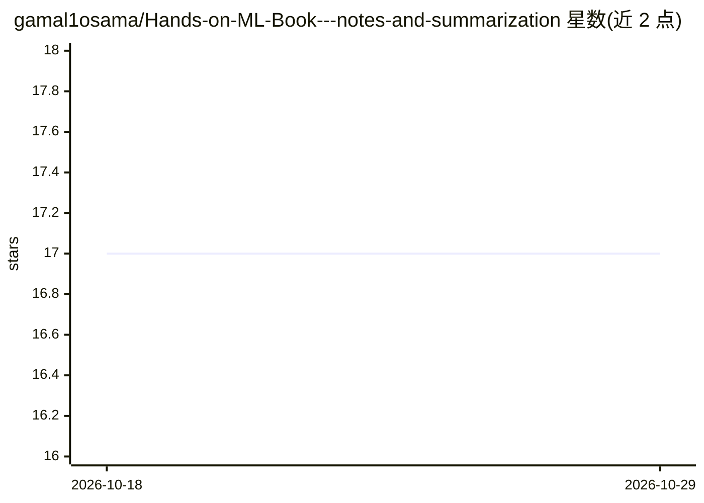

# gamal1osama/Hands-on-ML-Book---notes-and-summarization

⭐ 17 · 推送 2026-04-28 · [GitHub](https://github.com/gamal1osama/Hands-on-ML-Book---notes-and-summarization) · 个人维护

**《Hands-On ML》第三版逐章学习笔记与摘要仓库**

个人学习仓库，围绕 Aurélien Géron 所著《Hands-On Machine Learning with Scikit-Learn, Keras, and TensorFlow》(3rd Ed., O'Reilly) 制作逐章 PDF 摘要，用 Obsidian 组织内容并支持链接导航。每章含要点总结、练习及其解答指引（解答位于官方 notebook），并配套阿拉伯语讲解的 YouTube 播放列表作为辅助资源。面向使用该书的学生、自学者与阿拉伯语学习者，仓库本身不提供代码运行环境，练习实践依赖官方 GitHub 仓库或 Google Colab。

## 筛选速览

| 维度 | 判定 | 备注 |
|---|---|---|
| AI 角色 | `ai-knowledge` | 知识聚合/清单类 |
| 许可风险 | `none` | — |
| 部署形态 | `None` |  |
| 模型依赖 | — | README 未给出锁定关系 |
| 硬件要求 | — | 无带数字的原话,不猜 |
| 安装摩擦 | `low` | 无编译、无系统依赖或容器化 |
| 成熟度 | — | 结构信号不足 |

## 能力要点

- 逐章 PDF 摘要覆盖全书关键概念
- Obsidian 组织笔记，支持链接与导航
- 练习解答指向官方 notebook（GitHub/Colab）
- 配套阿拉伯语讲解播放列表

## 适用场景

- 配合原书逐章复习 ML 概念
- 查找各章要点的结构化摘要参考
- 按官方 notebook 路径做练习并核对解答

## 场景标签

`教程课程` · 领域:学习与行业

## 证据(README 行号)

> L3: Welcome to my personal repository for studying and summarizing the **"Hands-On Machine Learning with Scikit-Learn, K
> L15: - A concise **PDF summary** of key concepts and takeaways

## 星数曲线

2026-10-18 17 → 2026-10-29 17（+0）

---
*卡片 v1 · prompt 1.4 · 生成 2026-10-29 · 置信度 high · 依据 README sha `4ec3674e8cf8` · [字段定义](../../DATASET.md)*
