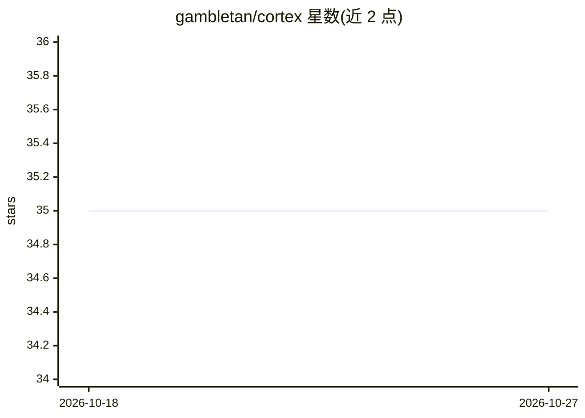

# gambletan/cortex

⭐ 35 · Rust · MIT · 推送 2026-10-22 · [GitHub](https://github.com/gambletan/cortex) · [官网](https://gambletan.github.io/cortex/) · 个人维护 · 中文 README

**给个人 AI agent 的本地优先端到端加密记忆引擎（Rust，MCP）**

纯 Rust 编写的本地记忆引擎，通过单个 MCP server 为 Claude Code/Claude Desktop 及任意 MCP 客户端提供跨会话持久记忆。记忆存于本地 SQLite，4 层记忆模型（工作/情景/语义/程序性），含贝叶斯信念、跨渠道人物图谱、整合引擎与多信号检索。零遥测；语义搜索首次使用需下载约 30MB 模型，也可设 CORTEX_NO_EMBEDDINGS=1 完全离线。可选 AES-256-GCM 加密同步经用户自有云盘，可选 Muse 分享仅上传经批准的摘录。分发为 3.8MB 单一二进制，支持 brew/cargo 构建/Docker，另有 124KB WASM 浏览器版本。

## 筛选速览

| 维度 | 判定 | 备注 |
|---|---|---|
| AI 角色 | `ai-ecosystem` | LLM/agent 周边工具 |
| 许可风险 | `permissive` | MIT |
| 部署形态 | `library` | 以包/库形式分发 |
| 模型依赖 | local-ok | 支持本地模型 |
| 硬件要求 | — | 无带数字的原话,不猜 |
| 安装摩擦 | `medium` | 含编译或系统依赖之一 |
| 成熟度 | `idea` | |

## 能力要点

- 单一 MCP server 接入 Claude 等 MCP 客户端，跨会话持久记忆
- 4 层记忆模型 + 贝叶斯信念更新 + 跨渠道人物图谱
- 本地 SQLite 存储、零遥测，可选经自有云盘的端到端加密同步
- 3.8MB 单一二进制，另提供 124KB WASM 浏览器版本

## 适用场景

- 让 Claude Code / Desktop 在新会话中记住我的偏好与决策
- 不把个人记忆数据交给云服务商，本地保存并加密同步多台设备
- 统一识别 Telegram/邮件/日历中同一个人的身份与关系

## 场景标签

`Agent 记忆` · 领域:Agent 开发

## 证据(README 行号)

> L25: - 🔌 **Drop-in for any agent** — one MCP server gives Claude Code / Claude Desktop (or any MCP client) persistent cr
> L33: claude mcp add cortex-memory -- cortex-mcp-server ~/.cortex/memory.db
> L16: **Your AI's memory archive lives on your device.** Pure Rust. 3.8MB binary. The local engine needs no hosted servic

## 星数曲线

2026-10-18 35 → 2026-10-27 35（+0）

---
*卡片 v1 · prompt 1.4 · 生成 2026-10-25 · 置信度 mid · 依据 README sha `ad1df5da849d` · [字段定义](../../DATASET.md)*
