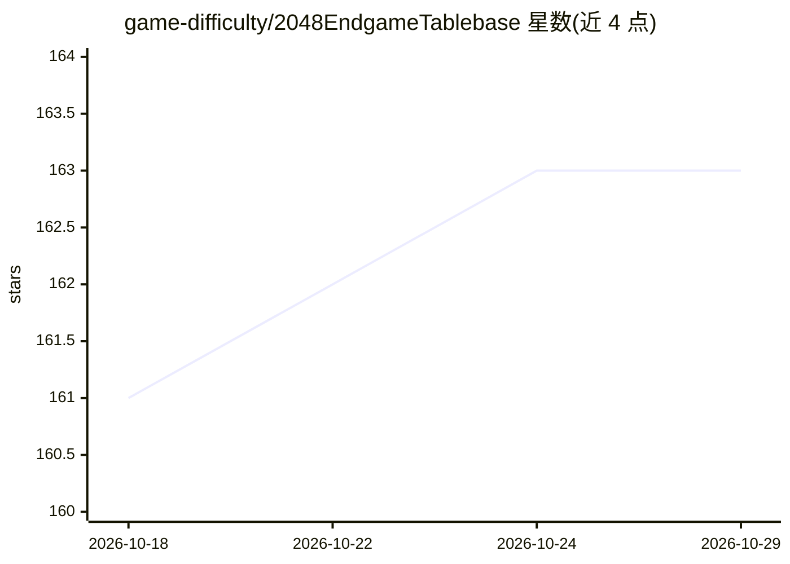

# game-difficulty/2048EndgameTablebase

⭐ 163 · C++ · GPL-3.0 · 推送 2026-10-17 · [GitHub](https://github.com/game-difficulty/2048EndgameTablebase) · [官网](https://2048tables.online/) · 个人维护 · 中文 README

**2048 残局表库 AI 引擎与表生成器，供玩家训练与自动对弈**

面向 2048 游戏的 AI 引擎与残局表库生成工具：通过预计算残局表（如 free12、4442f）结合搜索，在无撤销条件下达成 32768 块 86.1%、65536 块 8.4% 的成功率；内置 2.5MB 压缩残局表的独立配置可在静态网页部署。提供 GUI 训练工具（Auto-Demo、错误笔记、实时吻合率分析、支持 2048verse.com 导入复盘）。表生成部分采用位棋盘、大数掩码、启发式剪枝与批式反向 DP 等算法。Windows 7+ 64 位可直接运行（基础配置 8GB RAM），Linux 需从源码构建（Python 3.8+、Node.js、cmake、meson、g++ 等）。

## 筛选速览

| 维度 | 判定 | 备注 |
|---|---|---|
| AI 角色 | `ai-native` | 本体是模型或模型工具 |
| 许可风险 | `viral` | GPL-3.0 |
| 部署形态 | `library` | 以包/库形式分发 |
| 模型依赖 | — | README 未给出锁定关系 |
| 硬件要求 | — | 无带数字的原话,不猜 |
| 安装摩擦 | `low` | 无编译、无系统依赖或容器化 |
| 成熟度 | — | 结构信号不足 |

## 能力要点

- 预计算残局表+搜索混合：32768 块成功率 86.1%，65536 块 8.4%（无撤销）
- 2.5MB 超压缩残局表的独立配置，可部署于静态网页
- GUI 训练工具：Auto-Demo、错误笔记、实时吻合率分析、2048verse.com 复盘导入
- 表生成算法：位棋盘、大数掩码（0xF 抽象）、STSL 剪枝、批式反向 DP

## 适用场景

- 让 AI 自动对弈冲击 32768/65536 高分块
- 对照最优解训练自己的 2048 残局技术并记录错误
- 生成自定义残局表并复盘 2048verse.com 的对局

## 场景标签

 · 领域:游戏 AI/算法工程

## 证据(README 行号)

> L3: **2048EndgameTablebase** is the world's fastest and most space-efficient tablebase solution, designed to push the th
> L20: * **State-of-the-Art AI**: Outperforms all contemporary 2048 AIs by utilizing pre-calculated global optimal solutio
> L56: Tested over 1,200 games (Adaptive Search Depth 1~9, no undo):

## 星数曲线

2026-10-18 161 → 2026-10-29 163（+2）

---
*卡片 v1 · prompt 1.4 · 生成 2026-10-22 · 置信度 mid · 依据 README sha `1daab85ddd11` · [字段定义](../../DATASET.md)*
