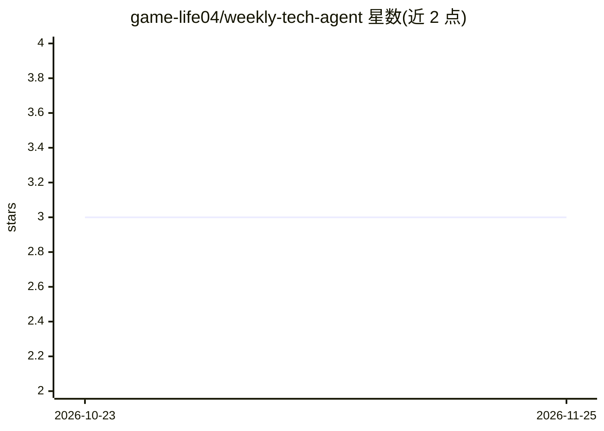

# game-life04/weekly-tech-agent

⭐ 3 · HTML · MIT · 推送 2026-11-23 · [GitHub](https://github.com/game-life04/weekly-tech-agent) · 组织维护 · 中文 README

**每日自动收集 AI/开源动态并生成日报周报的 Agent**

通过 GitHub Actions 每天定时运行的自动化资讯流水线：程序抓取 RSS 等信息源，去重、打分后由大模型（glm-4.7-flash）分栏改写，按《CCF开源快讯》体例生成每日快讯与每周快讯，8:30 推送到 QQ 群，内容存于仓库内可直接阅读，无需自建服务器。覆盖俱乐部动态、开源项目、学术前沿、会议截稿等栏目，AI 生成内容均有标注与原文来源。订阅方式包括 RSS 与 GitHub Releases 邮件通知，信息源与本地运行方法见 docs/about.md。

## 筛选速览

| 维度 | 判定 | 备注 |
|---|---|---|
| AI 角色 | `ai-native` | 本体是模型或模型工具 |
| 许可风险 | `permissive` | MIT |
| 部署形态 | `None` |  |
| 模型依赖 | — | README 未给出锁定关系 |
| 硬件要求 | — | 无带数字的原话,不猜 |
| 安装摩擦 | `low` | 无编译、无系统依赖或容器化 |
| 成熟度 | — | 结构信号不足 |

## 能力要点

- GitHub Actions 每日定时运行，无需服务器
- 自动抓取、去重、打分，再由大模型分栏改写
- 每日快讯 8:30 推送 QQ 群，每周一出周报
- AI 生成标题和正文均标注模型与来源，附原文链接

## 适用场景

- 每天快速浏览 AI 与开源领域要闻
- 以 RSS 或邮件订阅每周科技快讯
- 参考其体例搭建自己的自动化资讯聚合流水线

## 场景标签

`工作流自动化` `AI 写作` · 领域:效率与自动化

## 证据(README 行号)

> L113: 内容由程序自动抓取、去重、打分，再由大模型分栏和改写（页面上都有标注，可能有误，请以原文为准），GitHub Actions 每天定时运行，不需要服务器。收集哪些来源、怎么工作、怎么在本地运行和加一个信息来源，见 docs/ab
> L63:  标题和正文由 AI 根据原文整理（glm-4.7-flash），可能有误，请以原文为准。 俱乐部动态的统计日期为11月20日，数据来自俱乐部开源仪表盘。 会议截稿时间来自CCFDDL，已换算成北京时间，请以会议官网为准。 有新闻

## 星数曲线

2026-10-23 3 → 2026-11-25 3（+0）

---
*卡片 v1 · prompt 1.4 · 生成 2026-11-22 · 置信度 high · 依据 README sha `7bf801e7affa` · [字段定义](../../DATASET.md)*
