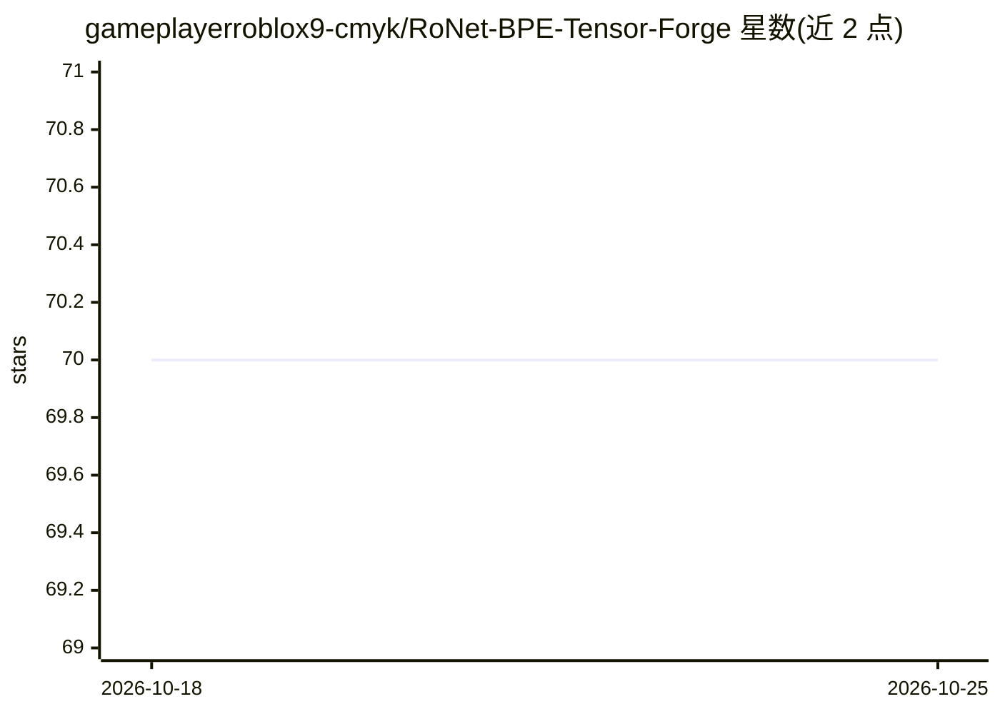

# gameplayerroblox9-cmyk/RoNet-BPE-Tensor-Forge

⭐ 70 · HTML · 推送 2026-10-24 · [GitHub](https://github.com/gameplayerroblox9-cmyk/RoNet-BPE-Tensor-Forge) · 个人维护

**纯张量实现的 Transformer 与字节级 BPE 分词器教学工坊**

用纯 Python 张量从底层构建 transformer 的实验性/教育性仓库：提供带形状追踪与 tape 式反向传播自动微分的张量模块、可拼装的编码器/解码器注意力组件、SGD 到 AdamW 的优化器与学习率调度器，以及可训练、检查合并表的字节级 BPE 分词器；附带响应式训练监控 dashboard、示例脚本与测试套件。免责声明明确不保证生产可用性与模型精度，性能说明中建议大规模负载换用编译后端。

## 筛选速览

| 维度 | 判定 | 备注 |
|---|---|---|
| AI 角色 | `ai-ecosystem` | LLM/agent 周边工具 |
| 许可风险 | `none` | — |
| 部署形态 | `None` |  |
| 模型依赖 | — | README 未给出锁定关系 |
| 硬件要求 | — | 无带数字的原话,不猜 |
| 安装摩擦 | `low` | 无编译、无系统依赖或容器化 |
| 成熟度 | — | 结构信号不足 |

## 能力要点

- 自研张量模块含 tape 式自动微分（reverse-mode autograd）
- 字节级 BPE 分词器支持训练/编码/解码与合并优先级检查，无 OOV 回退
- SGD/RMSProp/Adam/AdamW 优化器与 warmup、cosine、step 调度
- 响应式 dashboard 展示训练曲线、损失地形与注意力热图

## 适用场景

- 逐层拆解学习 transformer 内部机制
- 观察字节级 BPE 每一步合并决策
- 在手机或平板上远程监控小型语言模型训练

## 场景标签

`教程课程` · 领域:学习与行业

## 证据(README 行号)

> L8: RoNet is an experimental, educational, and production-curious repository that treats the transformer as a craft obje
> L31: - 🔩 **Tensor operations from scratch** — broadcasting, einsum-style contractions, and gradient bookkeeping without 
> L46: - **Ground Floor — Tensors:** The foundation. Everything rests on a minimal tensor object with shape tracking and r

## 星数曲线

2026-10-18 70 → 2026-10-25 70（+0）

---
*卡片 v1 · prompt 1.4 · 生成 2026-10-24 · 置信度 mid · 依据 README sha `2db4074d402b` · [字段定义](../../DATASET.md)*
