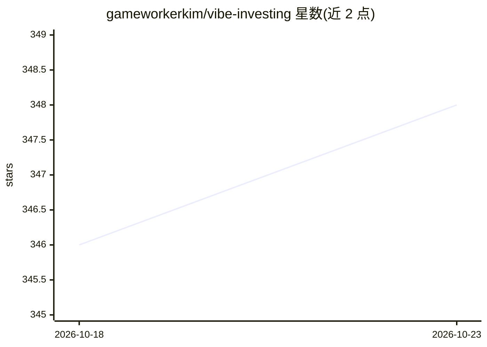

# gameworkerkim/vibe-investing

⭐ 348 · HTML · 推送 2026-10-22 · [GitHub](https://github.com/gameworkerkim/vibe-investing) · [官网](https://vibequant.cc/) · 个人维护

**个人维护的 AI 量化投资策展仓库：策略、工具与专栏合集**

个人作者（Dennis）维护的 Vibe Investing 仓库，以 AI/LLM 为工具研究纳斯达克、S&P500、加密货币等市场，聚合投资专栏、论文与多个子项目：Toss x AMQS 量化仪表盘（npm 运行）、ARDS-X 市场状态分类器（Python+FRED+yfinance）、DART 公示监控应用、TokenForge 韩语提示词压缩工具、CASSANDRA AI 公示分析、LAON VaultGuard 密钥审计工具等，并收录 LLM 交易机器人对比清单。仓库以文档与策展为主，更新周期不固定。

## 筛选速览

| 维度 | 判定 | 备注 |
|---|---|---|
| AI 角色 | `ai-knowledge` | 知识聚合/清单类 |
| 许可风险 | `permissive` | — |
| 部署形态 | `self-host` | docker 或自建部署 |
| 模型依赖 | — | README 未给出锁定关系 |
| 硬件要求 | — | 无带数字的原话,不猜 |
| 安装摩擦 | `low` | 无编译、无系统依赖或容器化 |
| 成熟度 | — | 结构信号不足 |

## 能力要点

- 聚合多个可运行子项目：量化仪表盘、ARDS-X 分类器、CASSANDRA AI、VaultGuard 等
- LLM 交易机器人 17 种对比清单（含 FinGPT/FinRobot）
- AMQS/ARDS-X 附带回测数据与源码（quant/ + dashboard/）
- 收录金融/量化 LLM 提示词实测评述

## 适用场景

- 查阅美股与加密货币的 AI 量化策略与工具评测
- 运行 Toss 仪表盘在国内股票上应用动量策略
- 用 ARDS-X 分类市场下跌状态并做策略切换
- 了解 LLM 交易机器人的风险清单

## 场景标签

`金融量化` `精选清单` · 领域:学习与行业

## 证据(README 行号)

> L3: > 인공지능을 도구로 활용한 바이브 투자(Vibe Investing) 큐레이션 · 전략 · 칼럼 · 논문 레포
> L5: AI를 엑셀과 같은 도구일뿐입니다, 시장의 소음에서 신호를 가려내는 관점과 저만의 솔루션을 공개합니다.
> L7: 미국 나스닥·S&P500, 가상화폐, 명품 섹터, 크립토-주식 상관관계를 리서치하며 파과적 혁신 산업에서 알파 수익을 추구하고 있습니다.

## 星数曲线

2026-10-18 346 → 2026-10-23 348（+2）

---
*卡片 v1 · prompt 1.4 · 生成 2026-10-22 · 置信度 mid · 依据 README sha `b3ba96073110` · [字段定义](../../DATASET.md)*
